<h1 align="center">t3term</h1>

<p align="center">
  <strong>T3 Code without the window.</strong>
</p>

<p align="center">
  A terminal client in Rust. One 5.4 MB binary: the whole interface with no arguments,<br>
  a CLI you can script with a subcommand. Your threads are the ones the app already shows.
</p>

<p align="center">
  <a href="#try-it"><strong>Try it</strong></a> ·
  <a href="#why-it-exists"><strong>Why it exists</strong></a> ·
  <a href="#what-you-get"><strong>What you get</strong></a> ·
  <a href="#its-a-cli-too"><strong>CLI</strong></a> ·
  <a href="#how-it-works"><strong>How it works</strong></a>
</p>

<p align="center">
  
  
  
  
</p>

<p align="center">
  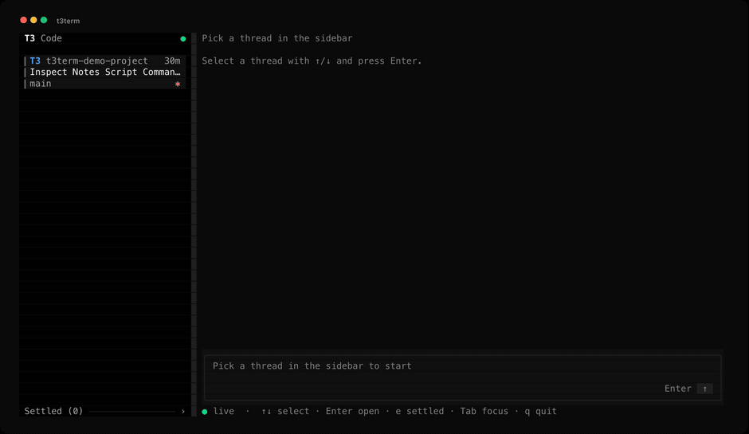
</p>

**New to T3 Code?** [It](https://github.com/pingdotgg/t3code) runs coding agents on your machine. Claude Code, Codex, Cursor, Grok and others, each working in its own thread on one of your projects, with approvals, permission modes and branches. It ships as an Electron desktop app, plus a web app and a phone app. t3term is the same thing as a terminal program. It connects to the T3 server you already run rather than starting one, so a thread you open here is the same thread the desktop app shows.

## Try it

There are no prebuilt binaries yet, so build it:

```bash
git clone https://github.com/krishhgg/t3term
cd t3term
cargo build --release

./target/release/t3term doctor   # does it see your server?
./target/release/t3term          # open the TUI
```

`cargo install --path .` puts `t3term` on your PATH instead.

You need T3 Code already running, either the desktop app or `t3` from [their installer](https://github.com/pingdotgg/t3code#installation), plus a Rust toolchain. t3term finds the server on its own and logs itself in, so there is nothing to configure. If `doctor` fails it names the step that failed. It cannot create a thread yet, so start one in the app and open it here.

Tested against T3 Code `0.0.46-nightly.20261007.2787` on orchestration protocol 2, on macOS. Linux and Windows have not been tried.

## Why it exists

**It's a TUI alternative to the desktop app.** Everything runs the same, you're just interacting through a terminal rather than a window.

**It's way lighter because it isn't a browser.** The desktop app is Electron, which means it ships Chromium, so a whole browser engine runs your window, with another process for the GPU and a few helpers around it, and one more every time you open a second window. That came out to about 1.1 GB in the run below. t3term is one Rust process drawing text cells, so it sits at 53 MB.

Both clients open on the same thread, on the same Mac, against one server holding 14 projects and 123 threads. Sampled every 5 seconds across a minute:

| | Memory | CPU |
| --- | --- | --- |
| T3 Code desktop windows (5 processes) | 1161 MB | 11.1% of one core |
| t3term (1 process) | 53 MB | 0.8% of one core |

Run `python3 benchmarks/compare_clients.py` with both clients open and it prints that table for your own machine. Memory is a sum of RSS, which overcounts pages the processes share, so read it as an upper bound.

Neither row counts what runs whichever client you use: T3's server itself used 449 MB, and the agents it had spawned used 2774 MB across 63 to 66 processes. The agents are the expensive part, and nothing here changes that. t3term replaces the window, not the engine.

Rust is a big part of why it stays that low, since there's no runtime or garbage collector underneath it and the whole binary is 5.4 MB. It only redraws when something actually changed, and never more than 30 times a second, so leaving a thread open costs you almost nothing. Long threads stay cheap too, because it only draws the lines that are on your screen instead of the whole history, which in the benchmark was around 12 times faster at 50,000 lines.

**It's scriptable.** Every subcommand takes `--json`, and `t3term threads --limit 1` answers in 30 to 50 ms using the saved login. Send a prompt from a git hook, wait for the turn, approve what it asks, read the result. One gap: when the agent asks a question rather than for approval, `requests` lists it but only the TUI can answer it.

**It's a client, not a fork.** t3term opens no database and starts no server. A thread you open here is the thread the desktop app and the phone app show.

<p align="center">
  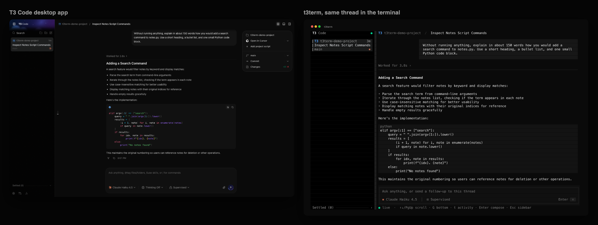
</p>

<p align="center"><sub>The same thread in both. The desktop app is on the left, t3term on the right.</sub></p>

## What you get

The TUI follows the desktop app closely, because muscle memory is worth more than a new idea here. The sidebar lists threads as cards with the project monogram, a status word or the thread's age, title, branch and provider glyph. A card or the breadcrumb cuts a title, a branch or a project's name to its row with `…`, and keeps accents and joined emoji whole. A line break or a tab shows as a space, and other control characters don't show. The monogram and its color come from the project's whole name. [Bounded titles verification](docs/bounded-titles-verification.md) has captures of a long CJK project name and of one with a tab and a line break in it. The status words, their order and their colors are the desktop's. Approval and Input mean the agent waits on you, and they come first. Working has a spinner and a clock, and reads Goal while a `/goal` is active. Waiting means background work will wake the agent. Limited is a run that hit a usage limit and Failed is any other failure. Woke marks a snooze that ended, until someone dismisses it in the desktop app or the thread moves on. Done marks a finished run nobody has looked at since. A card with no word shows the time of its last message. The cards sit on shelves in the desktop's order: Pinned, the inbox, Working, Done, Snoozed and Settled. Working, Done and Settled open and close, as [below](#the-sidebars-shelves). A snoozed thread comes back to its shelf when the snooze ends. Forks are listed like any other thread. Archived threads and subagents are not, and an agent's thread shows under Lineage in its parent's details instead. Your prompts are right-aligned bubbles. Approvals and questions open a panel above the composer with their keys printed on the buttons.

<p align="center">
  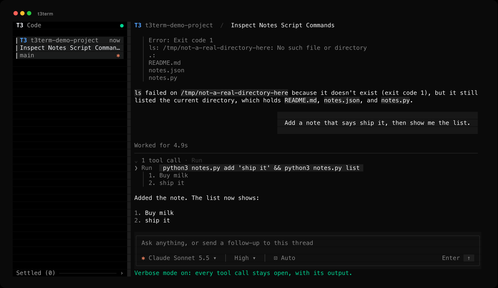
</p>

| Where | Keys |
| --- | --- |
| Anywhere | Tab / Shift+Tab move focus, Ctrl+B hide or show the sidebar, Alt+B open or close the thread's details, Alt+Shift+A [light, dark or the system's colors](#light-and-dark), PgUp/PgDn scroll, Ctrl+X interrupt, Ctrl+C quit |
| Anywhere, approval pending | Alt+A accept, Alt+S accept for session, Alt+D decline. Alt+↑/↓ or the wheel scrolls a long request |
| Anywhere, thread open | Alt+M model, Alt+E reasoning effort and other model options, Alt+P access, and plan mode once it's turned on |
| Anywhere, tasks drawer showing | Alt+T open or close the task list. Alt+↑/↓ or the wheel scrolls a long list |
| Anywhere, provider banner showing | Alt+N dismiss, Alt+O open or close the whole notice. Alt+↑/↓ or the wheel scrolls an open notice too long to show |
| Anywhere, error banner showing | Alt+W dismiss, Alt+I open or close the whole error. Alt+↑/↓ or the wheel scrolls an open error too long to show |
| Open menu | ↑/↓ choose, Enter select, Esc close. In the model menu, type to search |
| Sidebar | ↑/↓ or j/k select (↓ past the last thread scrolls on to the headings under it), Enter open, w, d and e open or close the Working, Done and Settled shelves, [ and ] narrow or widen the sidebar, 0 back to its usual width, q quit |
| Composer | Enter send (queues if the thread is busy), Alt+Enter or Ctrl+J newline, Ctrl+R swap in an unsent message, Esc to transcript |
| Transcript | ↑/↓ scroll, g/G top/bottom, t open or close every row of tool calls, p expand or collapse the first long plan in view, w open or close the worktree setup's details while its card is in view, Enter compose, Esc, ← or h sidebar, showing it if hidden |
| Thread details | → or l the Pull requests tab, ← or h back a step, Esc close the dialog or leave the pane. On the Thread tab ↑/↓ or j/k choose a Lineage row, or scroll when there is none to choose, Enter open the chosen row, PgUp/PgDn page, Home/g top, End/G bottom. On the Pull requests tab the same keys select a link, and Enter shows its details in the list's place, where they scroll and Enter or ← shows the list again. In the details ↑/↓ also choose a button or group of the Comments section once it is in view, and Enter does what the chosen one does |

The wheel scrolls the transcript and the sidebar. Clicking ◧ at the top left of the conversation hides or shows the sidebar, clicking ◨ at the top right opens or closes the thread's details, and dragging the sidebar's right edge resizes it. Clicking a thread opens it, clicking the Working, Done or Settled heading opens or closes that shelf, clicking a chip under the composer opens its menu, clicking the top row of the tasks drawer opens or closes its list, clicking × on a provider or error banner dismisses it, clicking elsewhere on a long notice or error opens or closes it, and clicking a row of tool calls opens that row. Clicking the top edge of a long plan, or its Expand plan or Collapse plan button, expands or collapses that plan. Clicking a worktree setup card's Details row opens or closes its details. Clicking a tab of the thread's details shows that tab. On the Thread tab, clicking a Lineage row opens that thread, shows more rows or opens or closes Previous agents. On the Pull requests tab, clicking a linked pull request selects it, or shows its details when it is selected already, and clicking `← List` above those details shows the list again.

On macOS the Alt keys need Option to send Meta: "Use Option as Meta key" in Terminal, "Esc+" for the Option key in iTerm2, or `macos-option-as-alt = true` in Ghostty.

An emoji that ends in U+FE0F, such as ⚠️ or ❤️, takes two columns in some terminals, such as Ghostty, kitty, WezTerm and tmux 3.6a, and one in others, such as tmux with `variation-selector-always-wide off`. t3term writes the cell after it before the emoji itself, so the rest of its row lands in place either way.

### Picking a model

A menu choice turns its chip blue and goes to T3 with the thread's next message, as in the desktop app.

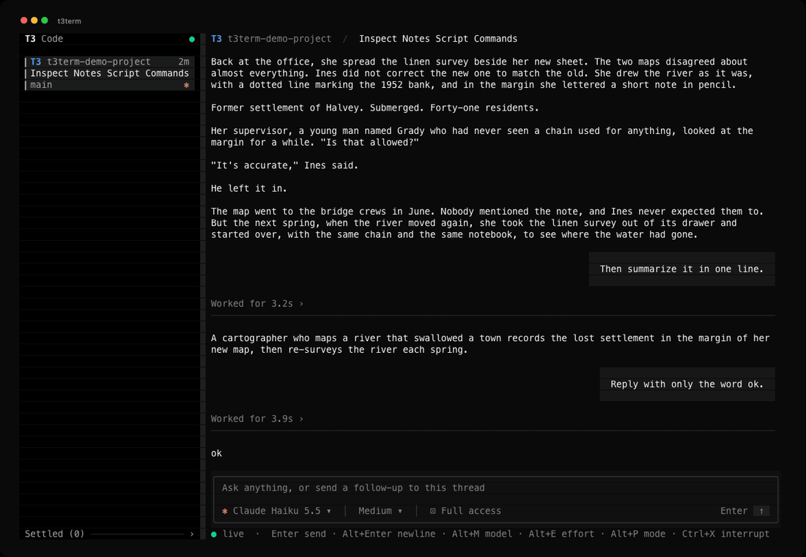

The chips and menus follow T3's provider list as it changes. The TUI subscribes to T3's server config, so when T3 adds or drops a provider, renames a model or gives a provider a status such as `error`, the chips and any open menu show it without reading the list again. The model menu shows a status after the provider's name. An open menu keeps its highlight on the same model as rows move. When a draft's provider goes away, its chip shows the thread's model, and the draft keeps the choice until the provider comes back. If T3 refuses the subscription, each menu reads the list with `server.getConfig` when it opens.

Ultrathink applies to that one message and comes back only if that message fails to send. T3 refuses a mode change while a run is active, so the TUI leaves the message in the composer to send once the run ends. That includes the switch back to Build below. A message that fails after you have typed something else or opened another thread is kept: the status line says so, Ctrl+R swaps it with the composer's text, and opening its thread with an empty composer brings it back. A send that times out can still reach T3, so if the thread later shows it, the TUI drops its kept copy rather than send it twice.

### Plan mode

Build and Plan are hidden by default, as in the nightly desktop app, which moved them behind a legacy setting. To bring them back, add `"planModeEnabled": true` to `~/.config/t3term/settings.json` and restart t3term. The desktop's "Plan mode (legacy)" switch uses the same key, though each app keeps its own copy. The Alt+P menu then has a Plan mode section, and a Plan chip shows while a thread plans. Providers without plan mode, such as Pi and Grok, never show either.

While Plan is hidden, the TUI sends every message in Build. A thread that the CLI, the desktop or an earlier t3term left in Plan goes back to Build with its next message from the TUI, as it would in the desktop. A model's Plan agent, such as OpenCode's, is hidden the same way. Alt+E leaves it out, and a thread saved on it sends its next message with the agent Alt+E shows, or with no agent when Plan was the only one. The setting changes nothing in the CLI, where `--plan`, `--no-plan` and `--option agent=plan` work either way.

### Proposed plans

A plan an agent proposes appears in the transcript as a card, like the nightly desktop's plan card. Its top edge has a Plan chip and the plan's title, which is the first Markdown heading in it, or "Proposed plan" when it has none. Inside is the plan as Markdown, without its title line or a Summary heading right under it. Cards show whether or not `planModeEnabled` is on. The checklist an agent keeps while it works is a different item. It stays a plain Plan row in the transcript, and the running turn's checklist also shows in the tasks drawer below.

A plan longer than 900 characters or 20 lines starts collapsed, as on the desktop. Characters here are UTF-16 code units, the desktop's measure, so an emoji counts as two. A collapsed plan shows its first ten lines with text, then `...`, and has an Expand plan button in its bottom edge. A click on the button or on the card's top edge expands it, and Collapse plan folds it again. With the transcript focused, `p` does the same for the first long plan in view, reading down from the top of the screen. A plan counts as in view while any of it shows, even after its top edge has scrolled off. With no long plan in view `p` does nothing, and the status line offers `p` only when it would act. A shorter plan shows in full and has no button.

Expanding or collapsing a plan keeps its top edge on the same screen row, so the text above it stays where it was. A collapse whose top edge had scrolled above the screen brings that edge back into view instead, as near the top row as the thread allows, so the shorter card doesn't end up out of view. Either way the view never scrolls past the end of the thread. When the card and what follows it are too short to reach the bottom of the screen from that row, the view stops at the end of the thread and the top edge sits lower. Expanding a plan near the bottom of the thread scrolls the view off the bottom, so new output stops pulling it down until you press G. A scroll that arrives before the screen redraws, such as G pressed right after p, wins, and the top edge moves with it. Each plan expands on its own. t3term remembers which are expanded only until you open another thread, and sends nothing to T3 or the settings file. The CLI prints plans as it did before.

The frame needs 17 columns, the width of the Collapse plan button and its two corners. A narrower card drops it. The Plan chip and as much of the title as fits take the top row, the plan follows at the full width, and a long plan ends with its button, cut short when the label doesn't fit. A click on either of those rows works as it does on the edges. Text too long for a row breaks onto the next one, mid-word if it has to, so none of the plan is cut off.

### Tasks

While a turn runs, the checklist its agent keeps shows in a drawer on the composer's top edge, as in the nightly desktop. Its top row names the step in progress, or the next one to do, or the last step once all are done. The row ends with the number of steps done, such as 2/5, which turns green when every step is done. In a drawer 60 columns or wider, a list of 2 to 10 steps adds a bar with a segment per step, colored by its state. Alt+T or a click on the top row opens the list under it. Each step has a mark, ✓ done, ◉ running or ○ to do, then its text and, on the right, a time. A finished step shows how long it took as T3 recorded it, and the running step shows `now`.

Alt+T is the drawer's only while the drawer shows. With no drawer, the key goes where it went before. Terminals send Esc then a quick `t` as Alt+T, so in the transcript that sequence still opens or closes every row of tool calls. While a drawer shows, the same Esc and `t` open its list instead, and a plain `t` still works.

The drawer shows the newest list written by the run that owns the thread's work, while that run hasn't ended. A new turn that hasn't written a list yet shows nothing, rather than the last turn's list. A queued message doesn't take the drawer from the run still working, and a list with no steps shows nothing. The drawer goes away when the run ends, while a request waits for an answer, and while the thread's watch connects or reconnects. When it comes back, its list starts closed, however briefly it was gone, as it does when you open another thread. Whether the list is open stays in this window, and t3term sends nothing to T3 or the settings file.

The open list takes at most 15 rows, the desktop's height, and at most 40% of the terminal. A longer list ends with a row such as `Lines 1-14 of 30 · Alt+↑/↓ scroll`, and Alt+↑/↓ or the wheel scroll it. With less room the list shrinks, and with none the drawer isn't drawn. The Alt+T label leaves a drawer under 40 columns, and a very narrow one shows only the count and the arrow. A long step breaks onto more rows, mid-word if it has to. CJK characters and emoji count two columns each, and an accented letter or an emoji such as 👩‍💻 or ⚠️ stays on one row.

In the transcript and in `t3term read`, a checklist shows as Plan rows marked `[x]` done, `[>]` running and `[ ]` to do.

An agent writes each step's text, so the drawer, the transcript and `t3term read` drop its control characters, such as Esc and the C1 codes, and a step can't move the cursor, clear the screen or set the clipboard. What followed an Esc stays as plain text. A carriage return starts a new row, and a tab or another blank control shows as a space. `t3term --json read` keeps the text as T3 sent it and writes each control character as a JSON escape, such as `\u001b` for Esc or `\u009b` for the C1 CSI. A terminal shows the escape as text, and a JSON parser reads back the original step.

### Worktree setup

While T3 sets up a worktree for the open thread, a card under the thread's first prompt shows how far it got, as the nightly desktop's worktree setup card does. The card only reads. It has none of the desktop's Cancel, Work locally or Open terminal buttons, and t3term never starts, retries or cancels a setup.

[](docs/worktree-setup-verification.md)

The thread and its setup are invented and come from a fake T3 server, and the image renders t3term's captured terminal output in truecolor. [Worktree setup verification](docs/worktree-setup-verification.md) lists what was checked, with captures of a checkout at 47%, a failed setup script in truecolor and 256 colors, a script still running after the agent started, a 42x18 screen and made-up Unicode and control text. A [capture slideshow](docs/screenshots/worktree-setup-capture-slideshow.mp4) steps through six of the captures. It is a slideshow of the captures, not a recording.

The TUI subscribes to T3's `subscribeWorktreeSetup` for the open thread while the thread has a worktree path or its latest run is preparing a worktree, which is when the desktop subscribes. Each open thread has one subscription. Opening another thread drops it, and so does the thread's watch closing. The TUI checks whether to subscribe when a thread opens, when T3 changes the thread or one of its runs, and when the sidebar's copy of the thread changes. A frame, a key or a piece of a streamed answer doesn't check, and the card never asks T3 for anything else.

The card's first row names the setup's state, such as `Setting up worktree…`, `Worktree ready, setup script failed` or `Worktree setup failed`, with the total time on the right. A row follows for each stage: fetching the base branch, checking out files, initializing submodules, the setup script under its name, and starting the agent. Each has a status mark, ✓ done, a spinner while running, ✕ failed, ! warning, − skipped or ○ pending, and its time. A running checkout shows its percentage, a skipped stage says why or `skipped`, and other stages show T3's note on what they did. While the script runs with output, and after it fails, four rows under it show its last four lines, so the card grows once and not with each line. A failed setup shows T3's error in up to six rows.

The card follows the desktop's rules for when it shows:

- A running setup always shows.
- A setup that finished cleanly shows until the agent's turn starts.
- A failed or cancelled setup, or one whose script failed, stays through the first turn. Once the agent has started and the turn is live, it shrinks to one row that says how it went.
- A setup script still running after the agent started is one row, such as `Install is still running`, with its time. The desktop shows a chip in its working header that opens the stages in a popover. t3term draws the row where the card was, and its Details row opens the stages under it.
- A second prompt in the thread retires any card except a running setup's.

`w` in the transcript opens or closes the setup's branch, base, path and script command under the card's Details row. It works while any row of a card with a Details row is in view, even after the Details row has scrolled off, and the status line offers `w` then. A click on the Details row does the same while that row is on screen. Opening keeps the Details row on the screen row it was on, on screen or off. Closing does too, except that a Details row above the screen comes to the top, so the shorter card doesn't leave an unrelated block in view. In the composer `w` types a w, in the sidebar it stays the Working shelf's key, and Alt+W stays the error banner's. A click acts on the row as the last frame drew it, so a click after a scroll, a resize, Ctrl+B or a new setup does nothing until the next frame. Whether Details is open stays in this window, and t3term sends nothing to T3 or the settings file.

T3 sends each setup whole, and the card shows the latest one for the open thread. A setup for another thread, or one that doesn't parse, changes nothing. The card drops control characters as the tasks drawer does a step's, so a script's output can't move the cursor or set the clipboard. It keeps at most 200 characters of a stage's note, 400 of an output line and 1,000 of the error, and a cut keeps an accent on its letter and an emoji whole. CJK characters count two columns, and a long branch or path is cut in the middle so both ends show.

T3 numbers a thread's setup changes and forgets a setup 30 seconds after it ends, sending null. Within one subscription a setup with a lower number than the one shown is older and is ignored. Null leaves the card as it was, as on the desktop. T3 counts from zero again after null and after it restarts, so after null or a reconnect the next setup replaces the shown one whatever its number. The desktop keeps comparing across those, and can keep an older setup on screen until the new one's number passes it.

If T3 refuses the subscription, which it does for a session or a server, or answers it with any other error, the TUI doesn't ask again for any thread until it restarts, and says nothing. The thread works as before, and the card keeps the last setup it had. If T3 ends a subscription without an error or the connection drops, the TUI subscribes again after a short wait, and the card keeps the setup it had until the new subscription sends one.

A card kept through a refusal, a reconnect, null or the thread's watch closing doesn't wake the TUI once a second, even if its setup was running when it came. The tick starts again once an open subscription sends a running setup and a frame draws its card. The card's times still move when something else draws a frame in a new second, such as a key, a server event, or the tick for a run on the open thread or a Working card in the sidebar. Each such frame lays a running setup's card out again at the current time.

A few things differ from the desktop:

- t3term's card always has its own first row. The desktop puts the label of a running or cleanly finished setup in the working row above its card.
- Details opens below its row. The desktop shows the details above its Details button, and always shows the button, where t3term leaves the row out when T3 sent no branch, base, path or command.
- With no prompt in the thread, the card follows the last row of the transcript.
- The card waits for the thread's state to load, and a follow-up prompt counts once T3 shows it in the thread.

### Provider status

When the provider the composer would send the next message with isn't ready, or runs a version T3 knows is broken or doesn't support, a banner at the top of the conversation says so, as the nightly desktop's does. It lies over the transcript like the thread error banner, and above it when both show.

[](docs/provider-status-verification.md)

The thread and its errors are invented and come from a fake T3 server, and the image renders t3term's captured terminal output in truecolor. [Provider status verification](docs/provider-status-verification.md) lists what was checked, with captures of an unsupported version, a sign-in error, a long notice, 256 colors and a 42x18 screen. A [capture slideshow](docs/screenshots/provider-status-capture-slideshow.mp4) steps through six of the captures. It is a slideshow of the captures, not a recording.

The provider is the one the model chip names. That is the model you picked for the thread and haven't sent yet, while T3 would still take it, else the thread's own model selection. The banner looks that provider instance up in T3's config by its id, so two instances of one driver, such as Codex and a second Codex for work, each have their own notice. It finds the instance even when T3 lists no models for it. With no thread open, or once T3's config no longer lists the instance, there is no banner, and t3term never shows another provider's status in its place.

What it says follows the desktop's `ProviderStatusBanner`:

- A provider in error that is signed out reads `Codex is unauthenticated`.
- A version T3 marks broken, or one it doesn't support on a provider that is otherwise ready, reads `Codex 1.2.3 is known to be broken` or `Codex 1.2.3 is unsupported`, with T3's advice as the message. Advice for a broken version comes before the startup failure it causes.
- Any other provider that isn't ready reads `Codex provider status`, with T3's message.
- A ready provider whose version T3 hasn't marked that way, a disabled one and an installed Antigravity whose sign-in T3 hasn't checked yet show nothing.

The name is the one T3 gives the instance, else the driver's id in words. The border is amber for a warning or an unsupported version, and red for an error or a broken version. When T3 sends no message, the banner gives the desktop's advice, with one change. t3term has no provider setup, so the advice names T3 Code's, as in `Open provider setup in T3 Code to sign in.` A provider whose setup can't sign in reads `Sign in via the CLI to authenticate again.` t3term doesn't install a provider or sign in to one.

Alt+N or a click on × dismisses the banner. As in the desktop, the window remembers one dismissed notice, until t3term quits, and sends nothing to T3 or the settings file. The notice stays hidden on every thread that uses that provider. A different notice shows, and if the provider then goes back to the dismissed one, it stays hidden. A provider with nothing to say clears the dismissal, and so does a selection whose provider T3's config doesn't list, so the notice shows again if it comes back after that. Dismissal goes by the provider instance, its state, its sign-in status and T3's whole message, or for a version, the instance, the verdict, the version and T3's whole advice. A message that differs from a dismissed one only past what the banner prints still shows.

The banner draws as the error banner does. A closed notice shows its title and at most three rows of its message, and its last row ends with `…` when there is more. Alt+O or a click on the banner opens the whole notice and closes it again, and an open notice too long for its rows scrolls with Alt+↑/↓ or the wheel. Opening one banner closes the other, so only one is ever open, and Alt+↑/↓ scroll that one before a request panel or the task list. The two banners share the top half of the transcript. While the thread has an error, the closed notice leaves the error banner at least three rows of that half, or half of it on a tall transcript. On a transcript under eight rows, the closed notice gives way to the error and doesn't show. An open notice takes the transcript's height, less the rows it leaves the error.

Alt+N and Alt+O are the banner's only while it shows, as Alt+W and Alt+I are the error banner's. The banner drops control characters, prints at most the first 4,096 bytes of the title and of the message, cut where a character starts, and says when it cut the rest.

The TUI works out the composer's provider only after something that can change it: a new config from T3, opening a thread, a change from T3 to the thread, a fresh copy of the thread after a reconnect, a send, and a pick from the model menu. Except after a new config, it first compares the thread, its model selection, its provider instance and the unsent pick with the ones it used last, and stops if they match. The banner then compares the notice with the one it has. Only a new notice is checked against the dismissed one and cleaned for printing, so T3 checking a provider and finding it as it was does no more than that comparison. A streamed answer, a redraw, and opening or scrolling the banner don't look at the provider at all, and the banner never asks T3 for anything, the model list included. A model list that comes back after a newer config can't bring back an older status, and while the config subscription reconnects, the notice stays as it was until the new snapshot.

### Thread errors

When a thread has an error, a banner at the top of the conversation shows it, as the nightly desktop's does. The banner lies over the transcript's first rows rather than pushing them down, so the text you are reading stays where it is. Its border is red, or amber for a usage limit. It is as wide as its text, up to 96 columns, and leaves a column of the conversation on each side.

| A provider session's error | A long error, open and scrolled to the end |
|---|---|
|  | 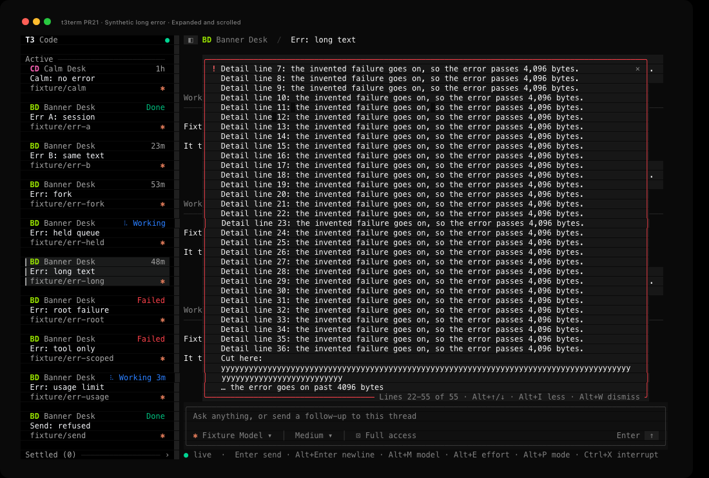 |

The threads are invented and come from a fake T3 server. The images render t3term's captured terminal output in truecolor. [Thread error verification](docs/thread-error-verification.md) lists what was checked, with captures of a usage limit in 256 colors and of a 30x10 screen. A [screen tour](docs/screenshots/thread-error-screen-tour.mp4) shows a long error closed, open and dismissed. It is a slideshow of the captures, not a recording.

The TUI picks the error as the desktop does. A send from this window that failed comes first, until the next send to that thread starts or the thread shows the message after all. Otherwise it is the error T3 holds for the thread: the last error of the thread's provider session, else the failure of the thread's latest run. A run's failure counts only when the run failed on its root node, so a failed tool call, a subagent's error, an older run's error and an error a fork inherited from its parent never show. A newer run replaces a failure as soon as it is queued, unless the queue is held. A usage limit is the exception: it stays the thread's error while newer messages wait behind it, until one of them starts. The banner is amber only when it shows the usage limit itself, so a different error from the provider session shows in red.

A send error belongs to the thread it went to. If it comes back after you have opened another thread, the banner waits for that thread, and the message is kept as before.

Alt+W or a click on × dismisses the banner. t3term remembers the dismissal until it quits, for that thread and that exact text, and sends nothing to T3 or the settings file. The error stays dismissed when you leave the thread and come back, the same text on another thread still shows, and a different error on the same thread shows again. Dismissing a send error shows the thread's own error if it has one.

A closed banner shows at most three rows of the error and at most half of the transcript, and its last row ends with `…` when there is more. Alt+I or a click on the banner opens the whole error, up to the transcript's height, and Alt+I or another click closes it. An open error too long for its rows shows a count such as `Lines 1-12 of 40`, and Alt+↑/↓ or the wheel scroll it. The banner's bottom edge names the keys that apply, as many as fit. A banner with fewer than 12 columns, or fewer than three rows it may take, has no border and shows only the text and ×. The wheel over a closed banner scrolls the transcript under it, and a click on the banner never reaches the row under it.

Alt+W and Alt+I are the banner's only while it shows. Terminals send Esc then a quick `w` or `i` as Alt+W or Alt+I, so while a banner shows, that sequence acts on the banner. Without one it does what it did before, and a plain `w` or `i` always does. Alt+↑/↓ go to an open error too long to show before a request panel or the task list. While a menu is open the banner's keys still work, and the first click closes the menu.

An error comes from a provider or a server, so the banner drops its control characters as the drawer does a step's. It prints at most the first 4,096 bytes of the error, cut where a character starts, and its last line says when it cut the rest. An error with nothing left to print, such as only spaces, shows no banner. Dismissal goes by the whole error, so an error that differs from a dismissed one only past those 4,096 bytes still shows.

A provider session's error can be any length, so the TUI reads it only after something that can change it. That is when you open the thread, when T3 sends a change to a run, a provider session, the thread or an error item, when T3 sends a fresh copy of the thread after a reconnect, when a send error comes or goes, and when you dismiss an error. A change from T3 copies the error out of the thread once. The banner then compares the whole error with the one it has. Only a new error is checked against the ones you dismissed and cleaned for printing, and the cleaning reads at most 4,096 bytes of it. A streamed answer, a redraw, and opening or scrolling the banner don't read the error at all.

The banner shows the thread's error only, and the provider banner above it shows the provider's status. A few things differ from the desktop. t3term shows a failed send's error as the client reported it, where the desktop sanitizes it first. A usage limit always shows in the banner, because t3term has no notice of its own for the latest run. A check that fails before a message goes out, and a failed interrupt or answer, still show only on the status line. The desktop also keeps a thread's error while a pull request watch holds the thread, and t3term doesn't.

### Context compaction

When an agent compacts its context, the transcript and `t3term read` show a marker for it, with or without a title from T3. The marker names the compaction's state: Compacting context while it is pending, running or waiting, Context compaction failed, Context compaction stopped once it was cancelled or interrupted, and Context compacted otherwise. The nightly desktop's timeline calls a failed or pending compaction compacted, where t3term names its state.

A compaction that finished with both token counts shows them in the marker, such as `Context compacted 899K → 19K tokens`. Otherwise the counts T3 sent go on the line under it, with `?` for one it didn't send, such as `899K → ? tokens`. t3term writes counts as the desktop does, so 1,500 tokens reads `1.50K`.

The provider's summary comes next, which the desktop's timeline leaves out. t3term shows up to twelve lines with text from its first 4,096 bytes, and a last line of `…` when there was more. It drops the summary's control characters as it does a checklist step's, and `t3term --json read` keeps the summary as T3 sent it. In the TUI the marker is a rule across the transcript with the label in the middle, blue while the compaction is under way, and the summary wraps under it in grey. When T3 updates the item, such as when a running compaction finishes, the same marker changes in place. The TUI cleans the summary and writes the counts once each time T3 changes the item, not on every redraw.

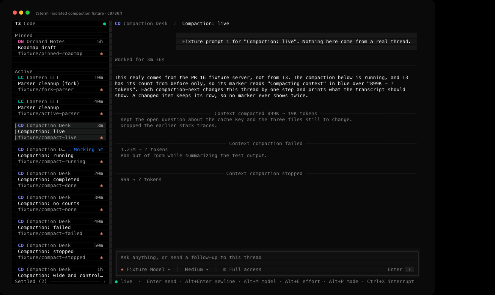

### Context handoff

When T3 hands a thread's context from one provider to another, the transcript and `t3term read` show a Context handoff marker, with or without a title from T3. The line under it lists the source models, then an arrow and the target model, such as `gpt-5.5, gpt-5.4 → claude-fable-5`. Sources keep T3's order, and past twelve a count such as `+3 more` stands for the rest. `t3term send --wait` and `t3term wait` print the marker and that line on stderr once, when a handoff in the turn they wait on has finished or failed.

Newer T3 servers stamp the models on the handoff. For an older handoff, t3term reads them from the thread's runs as the nightly desktop does. The target's model is that of the handoff's run, and each source's is that of the latest earlier run on its provider. An end with no known model shows its provider id, such as `codex_personal`. So does each end of a handoff that a fork inherited, because the fork doesn't have its parent's runs. The desktop shows names from T3's model and provider list, which `t3term read` doesn't fetch, so t3term shows the ids T3 sent.

Each end shows at most 64 columns and ends with `…` when cut. t3term drops its control characters as it does a checklist step's, and `t3term --json read` keeps the item as T3 sent it. In the TUI the marker is a rule like a compaction's, with the endpoints wrapped under it in grey and the label in red when the handoff failed. `t3term read` prints no colors, so a failed handoff reads the same there. The TUI works out the endpoints again when T3 changes the item and, for an older handoff, when a run is added or its model, provider or order changes, not on every redraw. A handoff stamped at both ends never reads the runs, and while no handoff in the transcript reads them, a run event doesn't make the TUI look the run up.

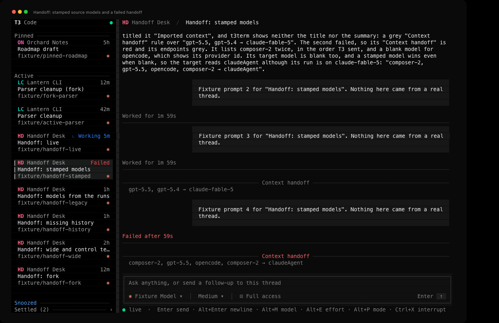

The thread is invented and comes from a fake T3 server. The image renders t3term's captured terminal output.

### The sidebar's shelves

The inbox is the desktop's Active shelf. It has no heading unless pins sit above it, where it reads `Inbox`. Working, Done and Settled each have a heading with the number of threads on the shelf, such as `Working (2)`, and a chevron at the end of its rule that points down while the shelf is open and right while it's closed. Those headings show once the list has any thread, even at a count of 0, so each shelf can be opened before it fills. When the whole list fits, they sit at the bottom of the sidebar, as the desktop's do, and the room left over goes above them. On a screen at least 20 rows tall, the sidebar keeps a blank row over the wordmark, level with one over the breadcrumb, and another over the list. A shorter screen gives those rows to the list and the conversation.

<a href="docs/sidebar-shelves-verification.md"></a>

The threads are invented and come from a fake T3 server. The image renders t3term's captured terminal cells in 256 colors, not a screenshot of a terminal app. [Sidebar shelves verification](docs/sidebar-shelves-verification.md) lists what was checked, including the defaults with no settings file, the migration of an old one, threads moving between shelves as a fake server changes them, folds by key and click, and screens of 120x19, 40x12 and 10x5.

Working holds the inbox's threads with a run under way, or with background work that will wake the agent, as long as nothing waits on you. An approval, a question, a failure or a plan waiting for your reply keeps a thread in the inbox. Pinned, snoozed and settled threads stay on their own shelves while they work. Working lists the thread you last sent a message to first, so a run finishing or waking again doesn't move a card. The inbox then lists the thread that most recently came back to you first. That is the latest of when it was created or reopened, when its latest run was requested or finished, and when it left Working, such as for an approval partway through a run. No server field records when a thread left Working, so t3term notes the moment it sees it happen. It forgets those moments when it quits, and it notes none for threads that were already waiting when it started.

Done holds the inbox's threads that read Done, whose latest run finished after your last visit, in the inbox's order. The desktop has no Done shelf and lists those threads in its inbox. t3term gives them a shelf of their own, so finished work you haven't read doesn't sit among the threads that wait on you. Opening one in t3term doesn't move it, because t3term doesn't report visits yet, as [Not done yet](#not-done-yet) says. Settled lists the newest settled thread first, one line each, with the project's badge, the title, and the card's word or how long ago the thread settled.

Working and Done start open and Settled starts closed. In the sidebar, `w`, `d` and `e` open or close them, and so does a click on a heading. In the composer the same letters are text. On a screen too short for the last thread and the headings under it, ↓ or the wheel on that thread scrolls on past it, then a row at a time, until the end of the list shows, and ↑ or the wheel up scrolls back before it moves the highlight. The cards below a heading move when its shelf opens or closes, so the sidebar draws the next frame at once, and a click on the list before that frame does nothing. A closed shelf still lists the thread you have open, so sending a message doesn't hide it. Closing the shelf the highlight is on moves the highlight to the next thread below it, or else the last one above. t3term saves each choice in `~/.config/t3term/settings.json`, under `sidebarWorkingShelfExpanded`, `sidebarDoneShelfExpanded` and `sidebarSettledShelfExpanded`. The desktop keeps its own in the browser's storage, so these keys are t3term's.

The Working shelf itself is the desktop's "Working shelf" setting, under the same key, `sidebarWorkingShelfEnabled`, though each app keeps its own copy. The desktop starts it off and t3term starts it on. To turn it off, set the key to `false` and restart t3term. Busy threads then stay in the inbox, the inbox takes the desktop's Active order, and Working has no heading. Earlier builds of t3term started with the shelf off and wrote `false` for both Working keys in every save, so a `false` there is almost always the old default rather than a choice. A file without `sidebarShelvesVersion` gets the shelf on and open once. The next save writes `"sidebarShelvesVersion": 1`, so turning the shelf off after that stays off. A file that already had it on keeps whether it was open.

The headings differ from the desktop's in two ways. The desktop counts a shelf only while it's closed, and shows Working only while it has threads. t3term counts each shelf open or closed and keeps the Working and Done headings at 0, so `w` and `d` have a heading to act on whenever the list has a thread. [Sidebar shelves](docs/sidebar-shelves.md) has the details and the sources.

### Hiding the sidebar

Ctrl+B hides the sidebar and gives its columns to the conversation. It works from any pane, with a menu open too, and never types into the composer. Ctrl+B again, or a click on ◧ at the top left of the conversation, brings it back. On the desktop, Mod+B and the panel button in the title bar do the same.

| Shown | Hidden |
|---|---|
| 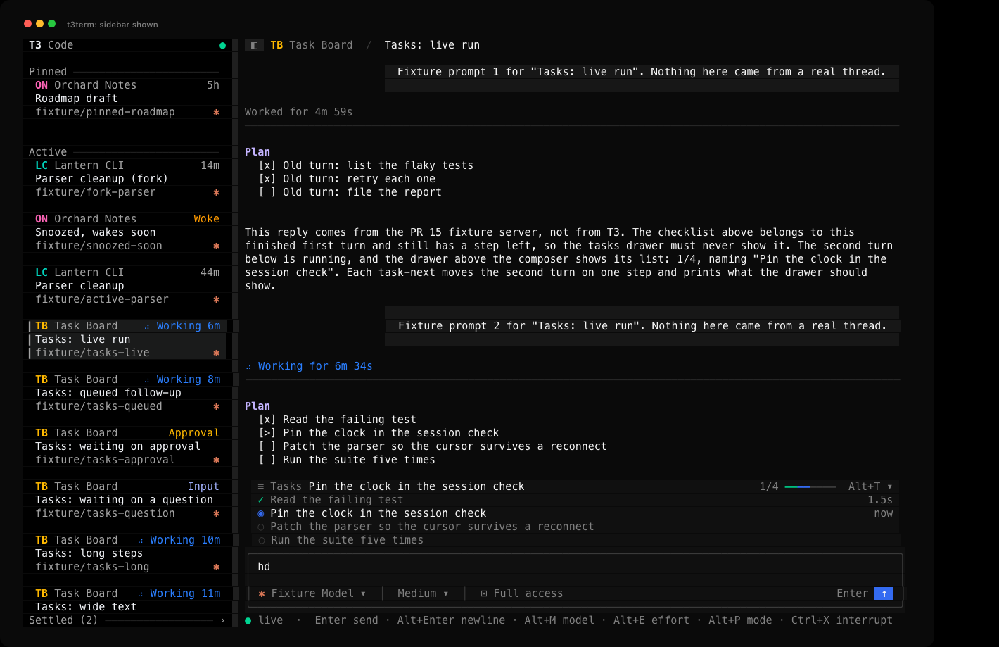 | 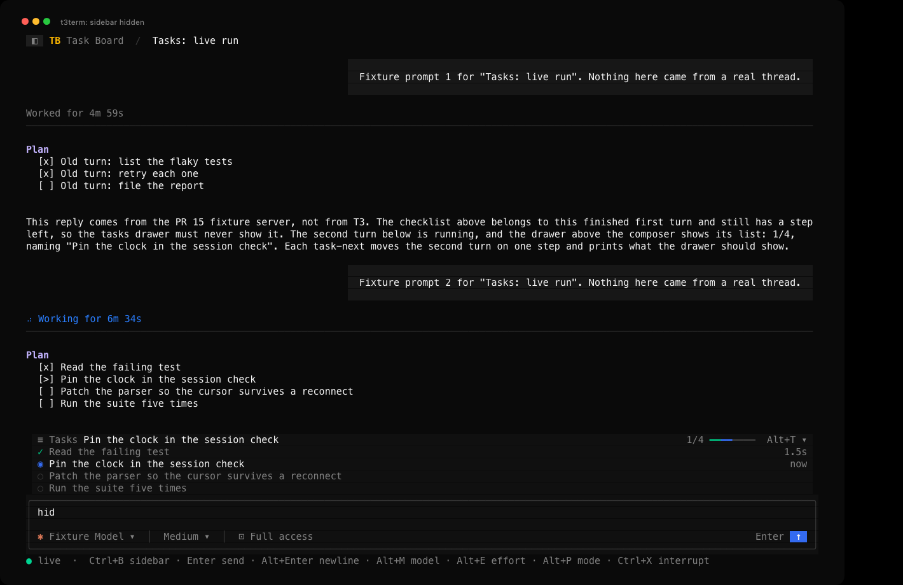 |

The threads are invented and come from a fake T3 server. The images render t3term's captured terminal output. A [screen tour](docs/screenshots/sidebar-screen-tour.mp4) shows these two and a hidden sidebar at 60x20 in 256 colors, for three seconds each. It is a slideshow of the captures, not a recording.

While the sidebar is hidden, the key hints on the status line start with `Ctrl+B sidebar`, and Tab and Shift+Tab move between the composer and the transcript. Esc, ← or h in the transcript show the sidebar and focus it. Hiding it while it has focus moves focus to the transcript when a thread is open, or else to the composer. The open thread, the draft and its cursor, and how far you have scrolled stay as they were. The sidebar keeps up with T3 while hidden, so it comes back with any new or renamed threads and with your highlight where you left it.

t3term saves the choice in `~/.config/t3term/settings.json` under `sidebarHidden`, so the next run starts the same way. A file without the key shows the sidebar. The desktop writes its choice to a cookie that it never reads back, so it opens with the sidebar shown every time, and this key is t3term's.

tmux uses Ctrl+B as its prefix. Inside tmux, press Ctrl+B twice to send one to t3term, or click ◧.

### Resizing the sidebar

Drag the sidebar's right edge, the one-column strip between it and the conversation, with the left mouse button. Or, with the sidebar focused, press `[` to narrow it and `]` to widen it by two columns. `0` puts back the width t3term picks, a quarter of the screen from 26 to 34 columns. On a screen at least 40 columns wide, the sidebar can be from 20 columns wide up to half the screen. A screen from 20 to 39 columns wide keeps 20 columns for the conversation and gives the sidebar the rest. Under 20 columns, the sidebar gets none and the conversation takes the whole screen. On the desktop you drag the edge of the sidebar and double-click it to reset. t3term has no double-click there, so `0` does the reset.

The edge follows the pointer while the button is down, and t3term saves the width when you let go. A click on the edge, or a drag that ends where it started, saves nothing, so the width still follows the screen. A key, Ctrl+B or a terminal resize during a drag puts the edge back where it was, and Esc does nothing else. With a menu open, the first press on the edge only closes the menu. A drag needs a terminal that reports the mouse moving while a button is held. Where it doesn't, `[` and `]` still work.

t3term saves the width in columns in `~/.config/t3term/settings.json` under `sidebarWidth`. A file without the key gives the width t3term picks. A screen too narrow for the saved width draws the sidebar narrower and keeps the saved width for when the screen grows again. The desktop keeps its width in pixels in the browser's storage, so this key is t3term's.

| Width t3term picks, 140x44 | Dragged to 51 columns, 140x44 |
|---|---|
| 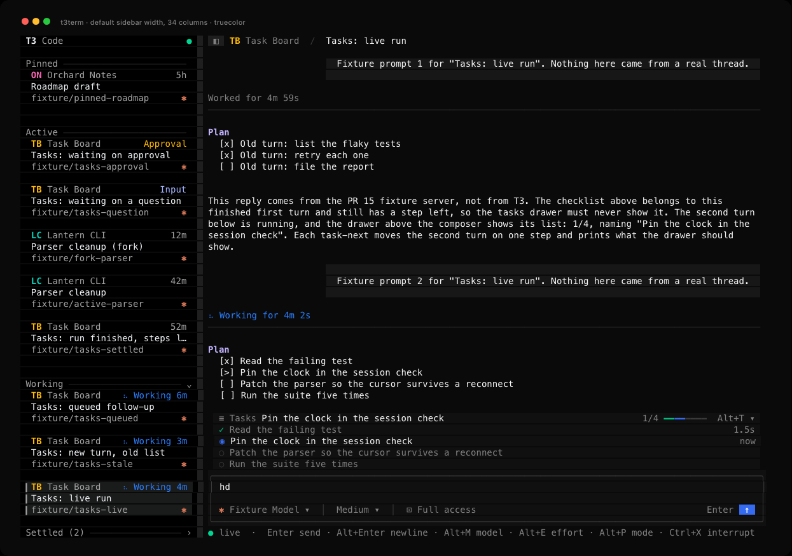 | 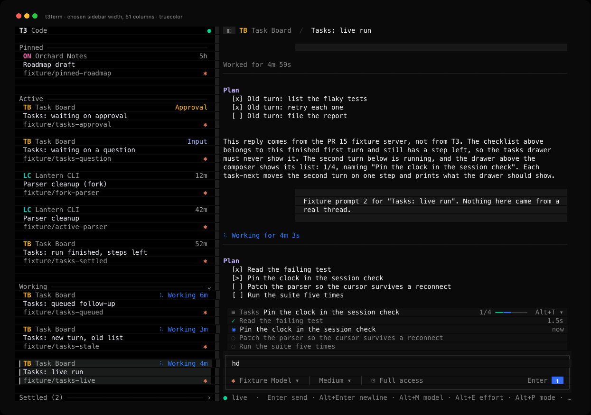 |
| **Saved 59, drawn at 40 on 80x24** | **Saved 48, 140x44 in 256 colors** |
| 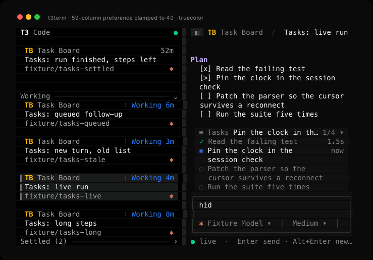 | ![A 48-column sidebar in 256 colors with Parser cleanup (fork) open and keep []0 draft unsent typed in the composer](docs/screenshots/sidebar-width-256.png) |

The threads are invented and come from a fake T3 server. The images render t3term's captured terminal output, the first three in truecolor. A [screen tour](docs/screenshots/sidebar-width-screen-tour.mp4) shows the four in this order for three seconds each. It is a slideshow of the captures, not a recording, so it shows neither the pointer nor the edge moving.

### The environment and its connection

The row under the sidebar's wordmark names the T3 environment t3term is connected to. It shows the label from the environment's descriptor, which the desktop's connection settings show too, then the host and port t3term reached, such as `Studio Mac · 127.0.0.1:3773`. t3term reads both once, when it starts, so a label changed while it runs shows after a restart. The address is only the host and the port. A user name, password, path, query or fragment in the origin, such as one set in `T3TERM_ORIGIN`, never shows, and neither does a port the scheme implies. The label loses its control characters, its line breaks read as spaces, and it ends with `…` after 64 characters. Without a label the address shows alone, and an origin that doesn't parse shows no address. When the row is too narrow for both, a domain name is cut in the middle in front of its whole port, down to three characters at each end, as in `stu…com:3773` for `studio.example.com:3773`. An IP address is never cut, so no digit of it or of its port goes missing. An address that doesn't fit is left out, and then the label is cut. At 80 columns the sidebar's row has 10 columns after `Studio Mac · `, too few for `127.0.0.1:3773`, so the label shows alone until the sidebar is dragged wider.

The dot by the wordmark shows the sidebar's own feed, T3's `orchestration.subscribeShell`, in the desktop's colors. It is amber and reads `connecting` until T3 says the feed has caught up, and then turns green. After a drop it is amber and reads `reconnecting` while the feed subscribes again, and the sidebar keeps its threads until T3 says the feed has caught up again. When T3 refuses the feed it turns red and reads `closed`. The watcher stops then, so the dot and its word stay after the error message goes, and the threads stay as they were until t3term restarts. A sidebar too narrow for the word shows only the dot's color.

The feed shares the TUI's one WebSocket with the open thread's watch, so a dropped connection usually shows in both. Nothing watches the socket itself, though, so the dot is the feed's state and not the connection's. The open thread's watch keeps its own state at the end of the breadcrumb and at the start of the status line. A thread whose watch closes doesn't turn the dot red, and a live thread doesn't hide a feed that dropped or closed. With no thread open, the status line names the feed's state.

[](docs/environment-chrome-verification.md)

The environment and its threads are invented and come from a fake T3 server, and the image renders t3term's captured terminal output in truecolor. [Environment chrome verification](docs/environment-chrome-verification.md) lists what was checked, with captures of the identity row, the sidebar hidden, a reconnecting feed, a thread whose watch closed beside a live feed, a hostile label, a 40x12 screen and 256 colors. A [capture slideshow](docs/screenshots/environment-capture-slideshow.mp4) steps through six of the captures. It is a slideshow of the captures, not a recording.

While the sidebar is hidden, or too narrow for its dot, the end of the breadcrumb's row shows the dot, the feed's word while it isn't live, and as much of the environment as fits. It takes at most a third of the row and leaves the thread's title its first 16 columns. As the row narrows the environment is cut and then left out, then the word goes, then the dot. The environment and the dot take no clicks and have no key, and t3term asks T3 for nothing more to show them.

### Thread details

Alt+B, or a click on ◨ at the right end of the title row, opens the open thread's details. Either one closes them again. The button is ◨ with a space on each side, three columns, and a blank column separates it from the breadcrumb, so the breadcrumb ends four columns sooner than it did. Under their title the details have two tabs, Thread and [Pull requests](#linked-pull-requests). The Thread tab shows four things:

- Project: the title of the thread's project, from the sidebar's feed.
- Workspace: `Worktree · feature-a` and the path under it when T3 recorded a worktree path for the thread. Otherwise `Local checkout · demo` and the project's folder. The name is the path's last folder, as the desktop names it.
- Recorded branch: the branch T3 recorded for the thread. t3term reads no Git, so it can differ from the branch checked out. A thread with no branch recorded reads `None recorded`, never main.
- Environment: the environment's name and address, as the sidebar shows them, when t3term has either.

`Loading…` stands in while the thread or its project is on its way. `Unavailable` replaces it once it won't come, and stands for a field that is missing or isn't text. A project without a folder reads `Project folder unavailable`, and so does a blank one, as a blank worktree path reads `Unavailable`. A path longer than 1,024 characters shows at most its first 256 and its last 768 characters with `…` between, and counts as blank when both of those parts are. Each part keeps whole letters and emoji, so it can hold fewer. The values come from what the thread's watch and the sidebar's feed already sent. While the thread's watch is open, its copy of the thread comes first, and after it closes the feed's copy stands in. The values change as T3 sends changes, and opening another thread shows its details from the next frame. t3term asks T3 for nothing more to show them. Text from T3 loses its control characters, and long values wrap to a few rows and end with `…`.

When the main column has room for a 36-column pane and still keeps 60 columns for the conversation, and the pane gets at least 12 rows, the details show in a pane at the right, from under the title row to the bottom of the composer. The conversation narrows to make room, and the transcript keeps its place. Otherwise they show as a dialog at the top right, up to 56 columns wide. At 120 columns that means a pane with the sidebar hidden and a dialog with it shown. The desktop's card works much the same way: it pins to the right of the chat while the chat keeps a readable width, and turns into a popover when it wouldn't.

<a href="docs/thread-details-verification.md">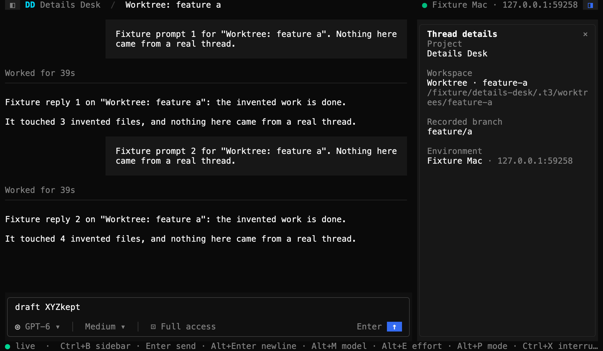</a>

The project, its threads and every path are invented and come from a fake T3 server. The image renders t3term's captured terminal cells in truecolor, not a screenshot of a terminal app. [Thread details verification](docs/thread-details-verification.md) lists what was checked, with captures of the pane at 200x50, a dialog with the sidebar shown, live updates, a missing project, the model menu, a 40x12 screen and hostile fields in 256 colors. A [capture slideshow](docs/screenshots/thread-details-capture-slideshow.mp4) steps through six of the captures. It is a slideshow of still captures, not a recording.

A pane leaves the keyboard where it was, so typing in the composer goes on. Tab reaches the pane after the transcript, and a click on the pane focuses it. Esc there gives the keyboard back to the pane that had it and leaves the details open. A dialog takes the keyboard and the mouse while it shows. Esc closes it before Esc does anything else, and so does a click outside it or on its ×. Ctrl+B, Ctrl+X, Ctrl+C and Alt+B still work over it, and opening one closes an open menu. When a dialog turns into a pane because the screen grew, the keyboard goes back to the pane that had it. The page keys, Home or `g` and End or `G` scroll the Thread tab's text, as the wheel over it does. The arrows or `j` and `k` choose a Lineage row when there is one, as below, and scroll the text past the rows or when there are none. Keys that come faster than the screen redraws scroll as they would with a redraw after each, so End and then ↑ stops a row above the end, and the text scrolls no further down than its last row.

#### Lineage

On the Thread tab, under the environment, the details list the threads related to the open one, as the desktop's lineage panel does:

- ↑ marks the thread it came from: the parent thread, or for an agent's own thread the parent agent.
- ↳ marks a fork of it, and a context transfer to or from it.
- ◆ marks an agent it delegated to. An agent that is still working stays in the list. One that finished, failed or stopped moves under `› Previous agents (N)`, which starts closed and counts the failed ones in the error color.

The parent comes first, then the thread a fork merges back to, then the newest. Each row ends with its status word, such as Running, Waiting, Done or Failed, in the desktop's words and colors. The heading reads `Lineage · 2 running` while agents run. An agent that T3 hasn't given a thread yet counts as running but has no row. When an agent's task has settled but its thread runs again, the row shows the thread's run. Each group shows its first 6 rows, and `+ Show 12 more` under it adds 12 at a time.

<a href="docs/lineage-verification.md">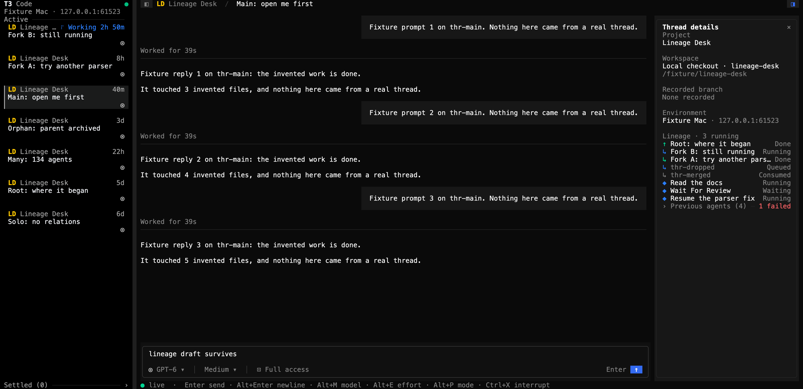</a>

The threads and agents are invented and come from a fake T3 server. The image renders t3term's captured terminal cells in truecolor, not a screenshot of a terminal app. [Lineage verification](docs/lineage-verification.md) lists what was checked, with captures of a thread with 124 previous agents, 7 of them failed, and of Previous agents open in a dialog in 256 colors.

When the details have the keyboard, ↑ and ↓ choose a row, and the status line says what Enter does with it, such as `Enter open fork` or `Enter show 12 more`. Enter or a click opens the chosen thread the way the sidebar opens one. The details stay open on it and keep the keyboard, the sidebar highlights it when it lists it, and the composer keeps its draft. The page keys, Home, End and the wheel scroll the text and leave no row chosen. A parent or an agent's thread that the sidebar's feed doesn't list, such as an archived one, shows with a muted title and doesn't open. Enter or a click on it says `This related thread is unavailable.` and stays on the open thread. The feed drops an archived fork, so the fork shows only through the fork transfer T3 recorded when it made it, if the open thread's watch has that transfer. It then reads as a muted ↳ row under the fork's id, with the transfer's status, and doesn't open. Enter asks the feed again before it opens a thread, so one archived or removed since the last frame stays closed. A click acts on the rows the last frame drew. After a scroll, a choice with ↑ or ↓, Show more, Previous agents, a resize or an event that changes the details, a click does nothing until the next frame draws them where they are now.

Lineage is worked out from the sidebar's feed and the open thread's watch, only after an event that can change it, and t3term asks T3 for nothing more to show it. The feed drops the open thread when someone archives it in the desktop, but the thread's watch still names its parent, so the parent's row stays, even after the watch closes. It opens while the feed lists the parent. When the open thread's watch closes, the feed still changes, so its copy of each thread it lists goes first, as it does for the rest of the details. An agent's thread then shows the feed's status and stays in Lineage only while the feed still lists it under the open thread. An agent or a context transfer the feed doesn't list keeps the status the watch last sent, so agents that finished stay under Previous agents. One that was still queued, running or waiting shows no status, because t3term won't hear how it ends, and an agent with no thread no longer counts as running. Only the rows a group shows get a title, and a frame looks for click targets only among the rows in view. Lineage only reads. It has no Stop, Merge back, Disconnect or new fork action, no elapsed time, provider icons or hover cards, and it shows the one T3 server t3term connects to.

The details start closed, on the Thread tab, every time t3term starts. Whether they are open and which tab shows aren't saved and don't change with the thread.

### Linked pull requests

The details' Pull requests tab lists the pull requests T3 linked to the open thread, as the desktop's panel beside its details does. → or `l` in the details, or a click on the tab's name, shows it, and ← or `h`, or a click on Thread, goes back to the Thread tab. Once T3 has sent the links, the tab's name counts them, as `Pull requests 2`, and it reads `PRs 2` on a card too narrow for that.

Each link takes three rows. The first has its state's mark, its number, its title and, when the host counted them, the lines it adds and removes, such as `+1,234 -56`. The second names its state: `Open`, `Draft`, `Merged` or `Closed`. While the link is open, `Watching` follows when T3 wakes the thread's agent for it, `Conflicts` when the host says it conflicts with its base and it isn't a draft, and its checks and review, such as `Checks passing` and `Approved`. When it last changed shows at the end of the row. The third has its repository and its head and base branches. A stack reads from its bottom layer up, its second, third and fourth layers each two columns further in than the one under it, and its bottom layer reads `Stack of 3` for a stack GitHub keeps, or `3 chained` for links where one's base branch is another's head branch. Links whose branches build on each other in a circle each show alone, and links that build on that circle chain only among themselves. The stack that changed last comes first. A footer counts the open and the linked pull requests and says when the host last synced one, as in `2 open · 2 linked · synced just now`.

Until T3 syncs a link with its host, the link reads `Waiting for host state`, with its host and repository under it. T3 leaves out what the host didn't report, and t3term shows nothing in its place. A missing check or review never reads as a pass or an approval, and a missing line count never reads as zero.

The arrows or `j` and `k` select a link, the page keys move a page of links, Home or `g` selects the first and End or `G` the last. The wheel moves the selection as the arrows do. A click on another link selects that one.

Enter, or a click on the selected link, shows its details in the list's place: its whole title, its status and line counts, its URL as plain text, its host and repository, its branches, its author, who linked it and when, when it last changed and synced, what watching it does and the stack it heads. Each value wraps to every row it takes. A row above them reads `← List` and says where the link is in the list, as `2 of 3`. The same keys and the wheel scroll the details, the page keys a page at a time, and End or `G` reaches the last row. A key or the wheel after End moves from the last row, even before the screen redraws, and ↓ or PgDn past the last row goes no further, so ↑ moves back at once. Enter, ← or `h`, or a click on `← List` shows the list again, with the link still selected. The details stay open on their link while the list changes around it, and close when T3 removes it. t3term opens no browser and has no copy key, so select the URL in your terminal to open it. A URL longer than the 2,048 characters t3term keeps ends with `…`, and a note under it says T3 sent a longer one, so the shown URL is never taken for the whole.

On an environment whose capabilities have `pullRequests`, opening a link's details also asks T3 for the pull request and its conversation, which T3 reads from its host on the server. The details read `Reading from github.com…` until T3 answers with the pull request, then `Read from github.com just now`, followed by what the desktop's Summary tab shows. A warning comes first while an open pull request that merges cleanly is behind its base, as in `This branch is out-of-date with master by 3 commits.` Then come the reviewers, one to a row with their last verdict at its end, such as `Approved` or `Changes requested earlier changes` for one given before the newest commit. The labels follow where the host has any or offers them, then the checks with each one's status, such as `✓ macOS  Passed`, and the description laid out as Markdown. The checks come before the description because the details can't fold a long description away as the desktop does. Last comes `Comments (12)`, which reads `Reading the conversation…` until the conversation comes. It shows the 10 most recent remarks newest first, as the desktop does, each with its author, its verdict or review state, how long ago, the file and line it is on and its text as Markdown without HTML comments. `Newest first` at the end of the heading switches to oldest first and back. `+ Show 10 older comments (15 hidden)` shows 10 more at a time, and `Show only 10 recent comments` goes back. Bots' remarks fold into `› 12 bot comments`, with who wrote them, on how many files and when the latest came on the row under it. Open, the group shows its 10 most recent and its own Show older button. Resolved and dismissed remarks fold the same way, and each shows on one row of its text until it opens. With a link's details open, ↑ and ↓ choose among these buttons and groups where they show, and scroll the details where none does, so the remarks between them are read on the way. Enter does what the chosen one does, the status line says what that is, such as `Enter show 10 older`, and a click on one does the same. What was opened starts over each time a link's details open. A read that fails says why in their place, such as the sentence the desktop shows when the server has no GitHub credential. Opening the same link's details again within a minute of the pull request's answer shows the same answers. After that, or after either read failed, it asks again. t3term keeps the answers for one link only, the one whose details opened last. It has one read under way at a time: a link opened during a read says it reads and is asked for once both of that read's answers came, and a link left before then isn't asked for at all. Nor is one whose details stop showing before then, as when the pane closes or the Thread tab shows, until they show again.

The status line offers the keys for the tab and for the list or the details. When the whole hint doesn't fit, it shows a shorter one, down to `Esc close` or `Esc leave` alone, so Esc shows at 80 columns beside the sidebar and at 40 columns without it. The keys follow how the same frame draws the details, so when a resize turns a pane into a dialog, the first frame already says Esc closes it. They also follow the links the same frame shows, so when T3 removes the link whose details show, the first frame without them offers the list's keys.

The links come from the thread T3 already sent: its `pullRequests`, or its one older `linkedPullRequest` when T3 sends no list. An empty list means every link was removed. Listing them asks T3 for nothing, and only opening a link's details reads its pull request. t3term runs no `gh`, reads no token, changes no link and starts or stops no watch. It hides the links the desktop hides, the `stack-dismissed` ones a reader unlinked from a stack, and shows each pull request once, by its host, repository and number. `Loading…` stands in while the thread is on its way and `Unavailable` once it won't come. An environment whose capabilities lack `threadPullRequests` reads `Linked pull requests unavailable`, as the desktop's panel does, and a thread with no links reads `No linked pull requests`.

t3term reads the first 1,000 links of a thread and counts the rest in the footer as not read. It reads them again only after an event that can change the thread, while the details are open, and a frame lays out only the links it shows. A link it can't read is left out and counted in the footer as unreadable. A click lands only on the rows the last frame drew. After a key, the wheel or a resize moves the selection or the details, a click does nothing until the next frame. Text from T3 loses its control characters, though the printable rest of an escape sequence, such as `[31m`, still shows as text. A title keeps at most 512 characters, a URL 2,048 and a host, repository, branch or author 256. From a host's answer, a reviewer, label, check name or remark's author keeps 256 characters, a remark's file 1,024 and the reason a read failed 1,024. A link whose host or repository is longer than 1,024 bytes counts as unreadable, before t3term trims or lowercases either. [Linked pull requests](docs/pull-request-panel.md) cites the T3 code each part follows and plans the next slices.

<a href="docs/pull-request-panel-verification.md">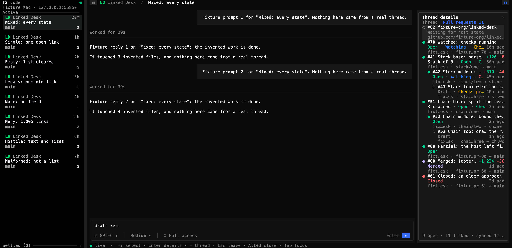</a>

The thread and its pull requests are invented and come from a fake T3 server. The image renders t3term's captured terminal cells in truecolor, not a screenshot of a terminal app. [Linked pull requests verification](docs/pull-request-panel-verification.md) lists what was checked at `407566d`, `eac6096` and `13b7a29`, including live link changes, with captures of a URL cut short in 256 colors, the dialog after a resize, links built on a cycle and the dialog with the capability off.

### Tool calls and reasoning

Reasoning is always there to read, laid out as prose in grey so the model's own answers stay the brightest text on screen. Tool calls are not: a run of them folds into one row saying how many there were and which tools ran, which keeps a turn short without hiding what it did.

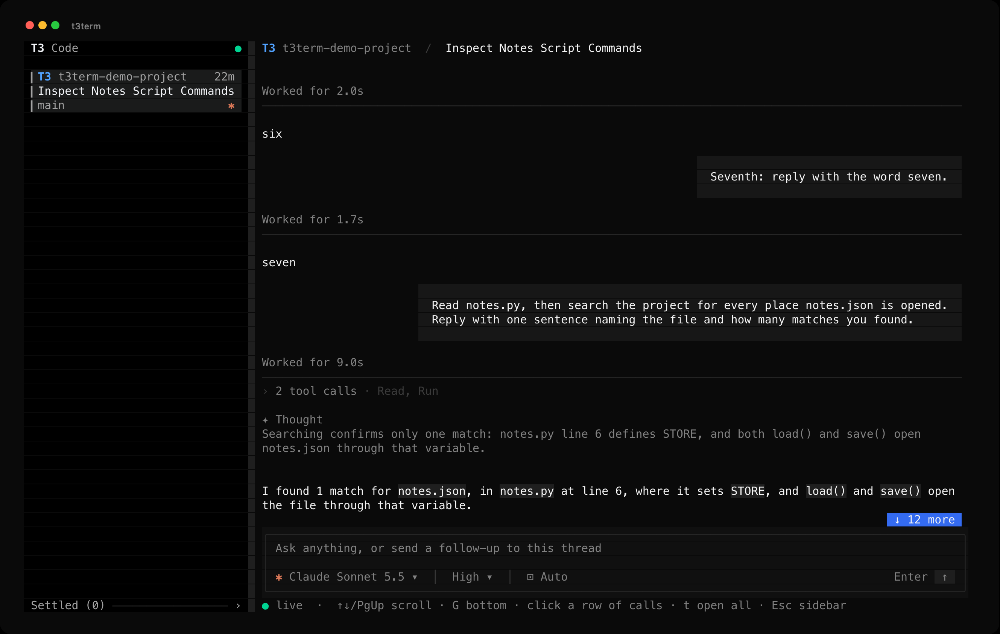

Click the row to open it. Each call is then one row with its icon, what it did and a chip holding the file, command or query it did it to, with the output quoted under it. A call that failed is red, and carries `exit N` when T3 reports the code. Clicking the row again closes it, and what you are reading stays where it is on screen while the rows above it grow.

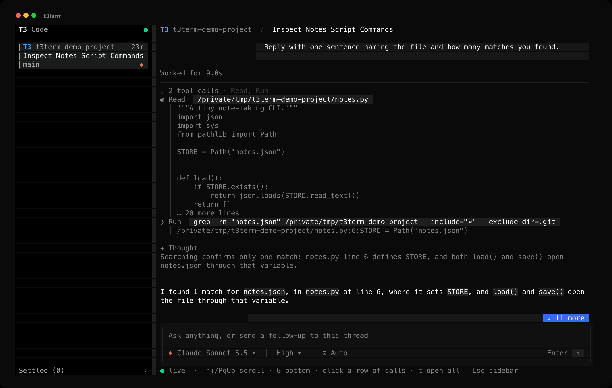

`t` opens every row at once and keeps new turns open, so a long run reads as it happens with no clicking. `t` again closes them all. The setting is saved in `~/.config/t3term/settings.json`, so it survives a restart. That file is t3term's own, not T3's. Each save reads the file again while it holds a lock on `settings.json.lock` beside it, then replaces the file whole, so a second t3term or a quick second `t` can't save over a change it hasn't read. If the file doesn't parse, t3term starts with the defaults and leaves the file as it is, so `t` saves nothing until you fix or delete it.

T3 leaves tool output out of a thread's projection so a large result can't stall the socket, and marks the item instead. t3term asks for it with `orchestration.getTurnItem`, only for the rows on screen, and keeps the answer until the item changes. Each row shows twelve lines: the first twelve of a file or a search, the last twelve of a command, where its result is.

Colors come from T3's dark theme. When `COLORTERM` reports truecolor the TUI uses the exact values. Otherwise, or when `T3TERM_COLOR=256` is set, it maps each one to the nearest entry in the 256-color palette.

### File changes

An edit's row reads `✎ Edit` with a chip holding the file and T3's line counts, such as `src/main.rs  +3 -1`. When T3 lists more than one operation in the edit, the chip counts the files instead, such as `2 files  +4 -2`, as the nightly desktop's `Changed 3 files` does. T3 counts lines for the whole edit and sends no count per file, so t3term never puts a count beside one path.

Open the edit's group and each operation T3 listed gets a line under the row. A move shows the old path and an arrow, and a file or MIME type follows in brackets when T3 sends one, such as `move /workspace/old.ts → /workspace/new.ts (text)`. The row lists at most twelve operations, and a line such as `… 988 more files` counts the rest. An entry without a path is left out and counted with the rest. When T3 sends no list, an empty one or one with no entry t3term can read, the row shows the file name alone.

When an edit fails, T3 sends the provider's error where a patch would be. The error comes first under the row, in red, and the operations follow, the order the desktop's item inspector uses.

The pinned nightly sends no patch for an edit that didn't fail, because the desktop reads full diffs another way. When a server does send one, t3term shows its start under the operations: hunk headers in blue, added lines in green, removed lines in red, file headers in bold grey and other lines in grey. The counts in each hunk's header say where the hunk ends, so a removed line that starts with `--` stays a removed line, and a text that isn't a patch reads as plain grey text. t3term never builds a patch of its own from the item's other fields.

An error or a patch shows at most twelve lines from its first 4,096 bytes, and a last line says what it left out, such as `… 18 more lines` or `… the text goes on past 4096 bytes`. t3term reads at most 1,024 bytes of a path, an operation or a file type, and ends one it cut with `…`. A line too long for the transcript ends in `…` at its edge, and a wide character or joined emoji that doesn't fit before it is left out whole. t3term drops the control characters of all of it as it does a checklist step's, and a tab shows as one space.

T3 sends the whole edit again each time it changes, such as when a running edit fails. The TUI describes the edit once for each change and draws it again in place, so a reader scrolled up stays on the same text. `t3term read`, `t3term send --wait` and `t3term wait` print the row alone, such as `edit src/main.rs  +3 -1`, with the file name cleaned the same way. `t3term --json read` keeps the item as T3 sent it.

There is no turn diff yet, and nothing opens an edit's full diff. Paths show as T3 sent them, not relative to the workspace, and the TUI doesn't show `oldStr` or `newStr`.

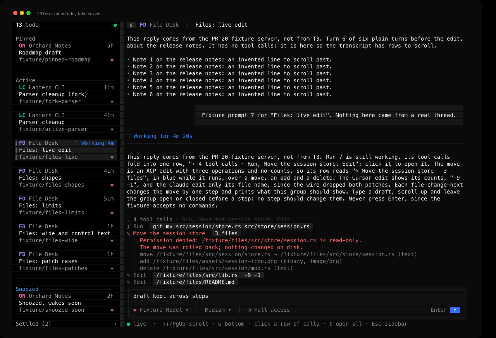

The thread is invented and comes from a fake T3 server that sends what the pinned nightly sends. The image renders t3term's captured terminal output. [File change verification](docs/file-change-verification.md) lists what was checked, with captures of the bounds, 256 colors, a narrow screen and a patch that only the fake server sends. A [screen tour](docs/screenshots/file-change-screen-tour.mp4) shows the live edit's captures in order. It is a slideshow of the captures, not a recording.

### Light and dark

Alt+Shift+A switches the colors to the next of System, Light and Dark, in the order the desktop's Cmd+Option+Shift+A uses, and the status line names the choice, such as `Appearance: Light`. Light draws T3 Code's light colors and Dark its dark ones. System draws whichever macOS shows. t3term reads that at start and again each time Alt+Shift+A comes back to System, so a change to macOS's appearance while t3term runs shows the next time you switch to System. On other systems System draws dark. On macOS, when the setting can't be read, System keeps what the last read that worked found, and draws dark when none has. The key works from any pane, over a menu or a dialog too, and never types into the composer. Like Alt+A, it needs Option to send Meta on a Mac.

| Dark, 120x48 | Light, 120x48 |
|---|---|
| 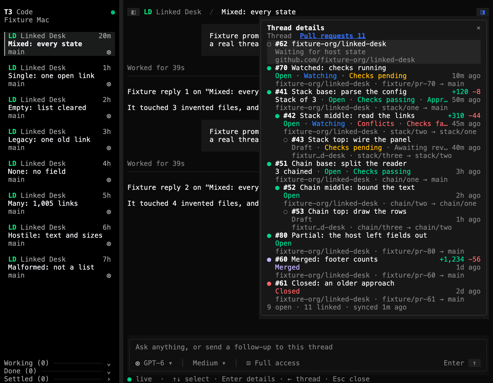 | 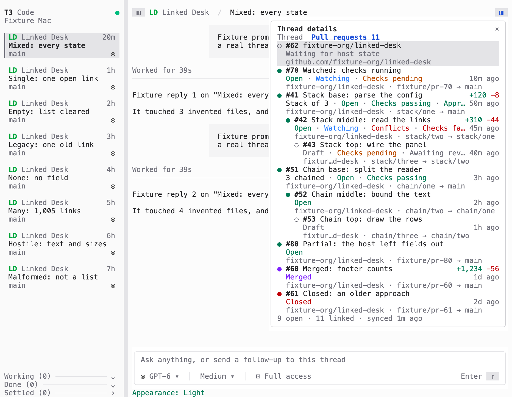 |

The threads and pull requests are invented and come from a fake T3 server. The images render t3term's captured terminal output in truecolor.

t3term saves the choice in `~/.config/t3term/settings.json` under `appearanceMode`, as `system`, `light` or `dark`. A file without the key, or with a value t3term doesn't know, draws dark, as t3term did before it had a choice. The desktop starts on System and keeps its choice in the browser's storage, so this key is t3term's.

Light uses the desktop's light colors, with a few exceptions. Where the desktop tells two surfaces apart by a border, or by a shade too faint for a terminal, t3term uses a darker gray: code blocks, inline code, a menu's highlighted row and the sidebar's active and selected rows. Chips are filled, as in dark. In 256 colors the light grays round to three, so the composer, menus and the sidebar share the canvas's white, and a code block in your own message has the message's background.

## It's a CLI too

```text
t3term doctor                       check discovery, protocol, auth and the WebSocket
t3term projects
t3term threads [--project P] [--all] [--limit N]
t3term read <thread> [--last N] [--reasoning]
t3term watch <thread>               live events; --json prints one item per line
t3term send <thread> [prompt] [--wait] [--timeout S] [--if-busy refuse|queue|steer] [choices]
t3term wait <thread>                stream the current turn until it ends
t3term requests <thread>            pending approvals and questions
t3term approve <thread> [--request ID] [--decision accept|accept-for-session|decline|cancel]
t3term interrupt <thread>
t3term models [--all]               providers, models and each model's options
t3term settings <thread> [choices]  show a thread's model and modes, or change them
t3term logout                       revoke the saved login and remove it from the Keychain
t3term environment list             saved environments; * marks the default
t3term environment status [<name>]  whether each saved server answers; never logs in
t3term environment add <name> --t3-home PATH [--origin URL] [--default]
t3term environment rename <name> <new-name>
t3term environment remove <name>
t3term environment default <name> | --clear
```

Add `--environment NAME` to any command to send it to one saved environment's server and no other. An environment is a T3 home on this machine and, optionally, its server's loopback origin. The `environment` commands need no server, except `status`, which asks each saved environment's server for its descriptor and logs in to none. [Environment connections](docs/environment-connections.md) covers the order t3term chooses a server in, the checks before it logs in and each error.

`<thread>` takes a full id, the 8-character prefix `threads` prints, or an exact title. `send` reads stdin when you leave the prompt out. Add `--json` to any command for machine-readable output. Inside its strings, every control character, DEL and the C1 codes included, is a JSON escape such as `\n` or `\u009b`.

Without `--json`, t3term drops control characters from what it prints on stdout and stderr: text from T3, the ids and names you pass and its error messages. A carriage return or `\r\n` prints as one line break, and a tab or another control that spaces text prints as a space. It drops every other control, C0, DEL or C1, so a thread title or a reply can't clear the screen, move the cursor or set the clipboard. What followed an Esc, such as `[2J`, stays as plain text, and accents, joined emoji and no-break spaces print as T3 sent them. `doctor` prints each check's details as JSON, escaped as `--json` escapes them. A usage error is the exception, because the argument parser quotes the command line as you typed it. `--json` keeps every value as T3 sent it.

Exit codes: 0 success, 1 failure or a turn that ended without completing, 2 usage, 3 not found, 4 rejected or unsupported protocol, 5 server unavailable, 6 timeout, 7 the turn is waiting for an approval or answer.

<details>
<summary><strong>Choosing a model, effort and mode from the command line</strong></summary>

The choices on `send` and `settings` are `--model`, `--effort`, `--option ID=VALUE`, `--mode` and `--plan` or `--no-plan`. Anything you leave out keeps the thread's current value.

- `--model` takes `provider/model` (for example `claudeAgent/claude-opus-5-5`), a model id, or a model name. A model id that two providers share needs the `provider/` part.
- `--effort` sets whichever reasoning option the model has: `effort` on Claude, `reasoningEffort` on Codex and Grok, `reasoning` on Cursor. `--effort ultrathink` adds `Ultrathink:` to the start of the message, as the desktop app does, and leaves the thread's effort alone.
- `--option` sets any other option the model lists, such as `fastMode=on` or `contextWindow=1m`.
- `--mode` is `approval-required` (also `supervised`), `auto-accept-edits`, `auto` or `full-access`.

`t3term models` lists the values each model accepts and marks defaults with `*`. t3term reads them from the server, so new models need no update here. Like the desktop app, `send` changes modes with their own commands just before the message and carries the model on the message itself, while `settings` applies the change right away. During an active run, `settings` refuses any change and `send` refuses a mode change, because T3 can restart the agent's session to apply them. `send` can still carry a new model on a queued or steered message.

</details>

## How it works

- **Discovery.** t3term chooses the server once per command, in this order: the saved environment `--environment` names, `T3TERM_ORIGIN`, the saved default environment, then the server `~/.t3/userdata/server-runtime.json` (or `$T3CODE_HOME`'s) records. A saved environment's server is the only one t3term tries, and t3term logs in only once that server reports the environment id its T3 home holds. `T3TERM_ORIGIN` works as before: when its server doesn't answer, t3term tries the recorded one. t3term checks `/.well-known/t3/environment` and refuses any server that is not on orchestration protocol 2. A saved environment's server that answers it with an error status, a body that isn't a descriptor or a body longer than 256 KiB stops the command with `T3_DESCRIPTOR_INVALID`. A saved environment's origin is http on this machine. t3term is built without TLS, so it refuses an https origin with `ENVIRONMENT_TLS_UNSUPPORTED`. It reads a T3 home's files once per command, off the async runtime, and only as small regular files. Every request goes straight to the server t3term chose, through no proxy. A redirect stops the command with `T3_REDIRECTED`, except in discovery without a saved environment, which passes that server over.
- **Auth.** On macOS, t3term keeps one login per T3 server in the login Keychain under the service `t3term`. It lasts 30 days, the same as T3's own default, and holds only `orchestration:read` and `orchestration:operate`. Each run checks it against `/api/auth/session`. If it expires within a day, or the server answers `authenticated: false`, t3term issues a new one and revokes the old one, so you never log in by hand. Any other answer, such as a redirect or an error, stops the command and leaves the saved login as it was. `t3term logout` revokes and deletes it. When a saved environment's server is stopped, logout removes that environment's login without a revoke, and only when nothing listens at its origin or its home records no server. It checks again while it holds the login lock and keeps the login if the server answers by then. The terminal connection, which no command opens yet, gets a session of its own with `terminal:read` and `terminal:operate` alone. t3term issues it only when a terminal first connects, keeps it 12 hours at most, never saves it and revokes it on exit. When the client drops, t3term closes the terminal's connection before it starts the revoke, and drops the socket once the WebSocket Close frame goes out or a second passes. A login never carries a terminal scope. [docs/terminal-auth.md](docs/terminal-auth.md) has the details.
- **RPC.** Effect RPC over `/ws`. Orchestration uses one connection, and the terminal, once something asks for it, opens a second with its own session. The client acks every stream chunk and pings every 10 seconds. If no frame arrives for 30 seconds it treats the socket as dead.
- **State.** Each V2 event carries the whole updated entity, so the reducer upserts it by id. After a dropped connection the client resubscribes with `afterSequence` and skips any replayed event it already applied.
- **Server config.** The TUI subscribes to `subscribeServerConfig` with an empty payload. Each subscription opens with a snapshot of the whole config and goes on with changes to the provider list, the settings or the keybindings. The stream has no cursor, so after a dropped connection the TUI keeps the config it has until the new subscription's snapshot replaces it. Retries wait 250 ms at first, doubling up to 10 seconds, and a snapshot brings the wait back to 250 ms. A server that refuses the subscription, because it lacks the method or the session lacks `orchestration:read`, gets a `server.getConfig` read each time a menu opens. The CLI reads `server.getConfig` when a command needs the model list.
- **Rendering.** The TUI draws only after input or a server event, at most 30 times a second. The open thread keeps its transcript blocks between frames and describes an item again only after T3 changes it, so a frame drawn for a key or the clock describes nothing. Each block keeps its wrapped lines until it changes or the width does, and only the visible rows are copied into a frame. While the open thread has a run going, the frame shows the card of a running setup that the open subscription sent since it last connected or sent null, or a card on screen reads Working or Goal, a once-a-second tick advances the spinners and clocks, and that tick stops when none does. The setup card is laid out again only when the setup, how it shows, Details or the width changes, or when a frame is drawn in a new second while the setup it holds is running. While a thread is snoozed, one timer waits for the soonest snooze to end, because no server event marks that moment. The same redraw moves the card back and shows Woke. Otherwise an idle TUI wakes only for input or server events.

<details>
<summary><strong>More on the saved login</strong></summary>

`doctor --json` reports the session's `scopes` and where its `login` came from: `saved`, `newly saved` or `temporary`. With the saved login a CLI command uses under 20 ms of CPU, and the session check against the server takes about 27 ms. Issuing a new session costs about 0.8 s, because it runs `t3 auth session issue` through the running server's own binary. t3term finds that binary from the server pid, since the `t3` on your PATH can be a different version. Override it with `T3TERM_T3_COMMAND`. For a saved environment, t3term issues the session with that environment's T3 home as `--base-dir`, and `t3term --environment NAME logout` touches that environment's login alone.

Set `T3TERM_NO_SAVED_LOGIN=1` to use a session that lasts one run instead. t3term revokes it on exit, including after Ctrl+C, `kill` or a closed terminal window. With it set, t3term reads, saves and deletes nothing in the Keychain.

</details>

## Tests

```bash
cargo test
```

The unit tests cover the reducers, Markdown wrapping, the composer, the model menus, the transcript, the cleaning of a reply that arrives in pieces and the lines under a file change, the tasks drawer, the thread error and provider status banners, the sidebar's shelves and their saved choices, hiding and resizing the sidebar, the environment's name and address, the thread details, their linked pull requests, auth command parsing, the saved environments file, the origins t3term accepts for one and the reads of a pull request's detail, checks and conversation. They check that a target a program builds by hand gets the same checks before t3term reads its T3 home or reaches a server, and that removing the login of a stopped environment removes that environment's login alone. It removes nothing for any other failure, such as an error status, a body that isn't a descriptor or a server that never answers, or while another t3term holds the login lock. Nor does it when a second check under that lock finds the server answering or the home changed, so a login saved for a server that started after the first check stays saved. Only `authenticated: false` renews a saved login, and a check that fails or redirects stops the login before it touches the Keychain or reaches the server the redirect names. The terminal session's tests run a fake `t3` in a temporary directory. They check that connecting a client issues nothing, that the first terminal call issues one session with the two terminal scopes alone for 12 hours against the environment's T3 home, that calls at once share it, and that only `permissions` naming exactly those scopes opens its socket. A failed check or connection keeps the session, and so does a WebSocket upgrade T3 never answers, which fails at the connect deadline. A rejected session is revoked and replaced once, and a cancelled call or a dropped client still revokes it, even while T3 holds the upgrade. Dropping the client closes the terminal's connection for every copy a caller holds before the revoke starts, and the login's socket stays open. An RPC test closes a connection whose T3 stopped reading partway through a write. Its waiting call and stream end at once, its socket drops within the one-second limit on the Close frame, and nothing after the cut write reaches T3. A close made before the connection's task first runs sends nothing it had queued. A server that is another environment now gets no token. A T3 home's files are read off the runtime, and a FIFO or a file over 16 KiB is never read. An https origin is refused wherever it comes from. They check that probing saved environments takes each on its own, runs at most eight probes at once, reports them in name order and never touches the Keychain. A connect that expects an environment id stops with `ENVIRONMENT_CHANGED` before any login when a saved environment's home and server have both changed to another id, or when discovery finds another server. A stand-in for the login counts its calls there. A test build lets a test give discovery its own `T3TERM_ORIGIN` and T3 home, so these tests don't read `~/.t3`. A matching id logs in once with the scopes and TTL given, the checks before a login keep their codes, the id is compared untrimmed and a blank one stops before t3term reads a file or reaches a server. A descriptor of 256 KiB in the shape T3 sends is read whole, with its length declared or in chunks. One byte more is refused either way, and a body past the cap is refused before it ends, whether its length is declared, it comes in chunks or it runs until the connection closes. A short body that stalls still waits out the 2.5 seconds. In a test build the Keychain is a stand-in that records each call, holds the logins a test gives it and never runs `security`. The TUI tests draw frames on ratatui's test backend with a client that never connects, and a test build keeps saved settings in memory, so no test writes `~/.config/t3term/settings.json`. `tests/fake_server.rs` drives the real RPC client against a fake Effect RPC server, dropping the socket mid-stream to check the resume cursor, chunk acks, batched frames, duplicate suppression and error decoding. Its pull request tests check the exact request for a pull request's detail, checks, conversation and refresh, and the failures T3 names, as [pull request reads](docs/pull-request-reads.md) says. Its config tests check the subscription's exact request, a fresh snapshot with no cursor after each drop, the backoff, stopping when the TUI goes while a watch connects or waits, and both ways T3 refuses the subscription. Its worktree setup tests check the exact request for one thread and that nulls and whole setups pass on as T3 sent them. They check that each reconnect sends the same request with no cursor, even after T3's count of a setup's changes starts over, and they check the backoff and both ways T3 refuses the subscription. Dropping a setup watch stops it while it waits to retry, and interrupts its own stream while the shell watch on the same connection goes on. The TUI's config tests run on a runtime that never polls its tasks, so they can count each model-list read the TUI starts and show which changes reach the chips and menus without one. The TUI's worktree setup tests stand in for the subscription, so they count each one the TUI opens and send setups down it. They take a thread through progress, the agent starting, a script still running and a clean finish, through failed, cancelled and script-failed setups before and after a follow-up, and through nulls, lower numbers, reconnects, refusals, thread switches and malformed setups. They check `w` and clicks, the Details row staying in place, the rows you are reading staying put while the card above grows, cleaned text, narrow windows and that only a running setup's card in view keeps the clock ticking. The sidebar's feed tests take it through connecting, a snapshot, catching up, a drop and a refusal, beside a thread whose watch is live or closed. They check that the dot and its word follow the feed, that the status line and the breadcrumb follow the thread, that a closed feed stays closed after its message goes, and that none of it starts a read or the tick. The environment's tests check that a label's control characters and an origin's credentials, path, query and fragment never reach the screen, that an address shows its whole port or doesn't show, that it fits from 24 to 200 columns with the sidebar shown or hidden, and that it takes no clicks. The thread details' tests take them through a pane and a dialog at sizes from 200x50 down to an empty screen, Tab, Esc, clicks and the wheel, a thread switch, a watch that closes before it answers, events from the feed and the watch, and hostile and huge fields. They check that the draft, its cursor and the transcript's place stay as they were, that a click lands only where the last frame drew, that the last thread's values never come back, that only an event that can change the values works them out again, and that none of it starts a read or the tick. The Lineage tests build the desktop's rows, order, groups and status words from the feed and the thread's projection, with cycles, duplicates, self links, bad ids, threads the feed doesn't list, archived copies and an archived fork that only its fork transfer names. A live run outranks an agent's settled task. They page 124 agents by 12 and count the 7 that failed, keep hostile titles to their rows at every width, and check every cell at 200x50, 120x36, 80x24 and 40x12 with the sidebar shown and hidden. They open related threads with Enter and with clicks in a pane and a dialog, and back to the parent. Each open starts one watch, the details keep the keyboard and the draft keeps its cursor. A thread that can't open only says so, and a click before a frame draws a change does nothing. In a pane and a dialog, a click after the wheel, the page keys, Home, End, ↑, ↓, Show more, closing Previous agents or a resize, and before the next frame, opens nothing, and a click on the row the next frame draws there opens that row. Keys and the wheel before a frame scroll the details as they would with a frame after each: End and then ↑, `k`, PageUp, the wheel or Home, pages past the end and back up a row, and ↓ through rows below the last one in view and then the wheel. The status line says what Enter does with the row the same frame draws. Enter opens nothing for a thread archived or removed since the last frame, and still opens one that was only renamed or changed its status. After the thread's watch closes, the feed's copy of an agent's thread goes first, and agents only the watch knew of no longer count as running. When the feed drops the open thread, the watch's copy still names its parent, with the watch open or closed, and Enter opens the parent. That parent shows muted when the feed doesn't list it either. A projection of another thread names no parent, and the feed's first copy of a thread it lists outranks the watch's. After paging, each frame gives every Lineage row in view a click target and no other row one, at the top and bottom of the view and in panes two, one and no rows high, and it highlights the chosen row only while that row shows. Lineage is worked out again for a child's status, a new fork or an agent's event, and not for a frame, a key, a streamed answer or another thread or project. The linked pull requests' tests read links in the shape the pinned T3 contract gives them and the older single link. They check tombstones, one row for each pull request, stacks GitHub keeps, stacks chained by branch, links that build on a cycle in every order T3 could send them, links T3 hasn't synced or left fields out of, unreadable lists and links, and an environment without the capability. They check that a missing check, review or line count never shows as a pass, an approval or zero. They draw hostile, wide and huge text and 1,200 links at 200x50, 120x36, 80x24 and 40x12, with the sidebar shown and hidden and a link's details open and closed. They scroll a link's long details to their last row with the keys and the wheel and go back to the list with the link still selected. They check that the status line's keys fit every width and show Esc wherever it fits, that the first frame after a resize, an open, a close or a change T3 makes to the links offers the keys for what it draws, that the links are read once, that a frame lays out only its page, that the selection and open details stay on their link as the list changes, that keys, clicks and the wheel reach the tab, that a click after keys, the wheel or a resize does nothing until the next frame, that another thread's events and a late copy of the last thread change nothing, and that the draft, focus and transcript stay and nothing starts a read or the tick. Two more give the environment `pullRequests`. Opening a link's details asks T3 once for that link's host, repository and number through the thread's project, and the details read `Reading from github.com…` and then the host's answer in the desktop's order. The conversation then shows the remarks and each reviewer's verdict in the desktop's order, without the HTML comments in a remark. Opening it again within a minute of the pull request's answer asks nothing, even when the host took most of a minute, and a late answer to an earlier ask changes nothing. A link opened while a read is under way waits for both of that read's answers, and one left before then is never asked for. Neither is one whose pane closes or whose Thread tab shows before then, until its details show again. A failure shows cleaned and cut to its bound, and the next open asks again. Without the capability nothing asks. Another test puts Lineage and two links on one thread and goes from the Thread tab to the list, a link's details and back, in a pane and a dialog. It checks that each tab keeps its scroll and choice, that the first frame on each offers its keys, that a click before that frame does nothing, and that no tab switch works the facts, Lineage or the links out again. Enter on the pane and a click on the dialog then open the chosen fork with one watch, and the draft keeps its cursor. The long-title tests cut text full of control characters, line breaks, wide characters, joined emoji and runs of accents at widths up to 40 columns. They check that a row reads no further than it can show, and that a row of no columns shows and reads nothing, even of a lone accent or joiner. They draw a huge hostile title and branch beside a short title at 200x50, 120x36, 80x24 and 40x12, with the sidebar shown and hidden. Nothing else on the screen moves. The environment shows as it does beside the short title, and any address it shows keeps its whole port. The draft, focus and reading position stay. They also check that a project's badge is worked out again on a rename, a removal, a restore or a snapshot, and never for a frame or another event. The wide emoji tests draw frames through the TUI's backend into a model of a terminal that draws an emoji with U+FE0F a column wide, and one that draws it two. Each frame shows in both where ratatui put it, and ratatui's backend alone moves the row in the second. `tests/cli.rs` runs the built binary with a temporary home and checks the `--json` error and exit code when the server is gone, when it isn't on protocol 2 and when the TUI has no terminal. It also runs `t3term read` against a fake server and a fake `t3` that issues a made-up session. It checks that the plain output drops the control characters of a checklist, a compaction summary and an edit's file name, and that `--json` writes them as escapes that decode to the text T3 sent. Each edit prints as one row, without its operations, error or patch. Another test runs `t3term send --wait` against a fake server that also plays T3's side of the WebSocket. It checks that each finished handoff in the turn prints its marker and endpoints on stderr once, even when T3 sends the item again, and that `--json` prints only the result. A test of `t3term wait` checks that each edit in the turn prints its row on stderr once, when it finishes, however often T3 sends it again. Three more check how a wait ends. `t3term wait` exits 7 with the outcome `needs-attention` when T3 asks for an approval, and 1 with the outcome `failed` when the run fails, with the reply so far on stdout. `t3term send --wait` exits 6 with `THREAD_WAIT_TIMEOUT` when the turn outlasts `--timeout`, and the error names the message it sent. Six more send made-up control characters through `read`, `projects`, `threads`, `wait`, `send --wait`, `watch`, `requests`, `approve`, `interrupt`, `models`, `settings`, `doctor` and the error report. They check that the plain output drops them and measures columns without them, that a reply printed as it streams matches the whole reply once cleaned, and that `--json` keeps every value as T3 sent it, as do the ids t3term sends back. Eight more cover saved environments. One makes A the default, the server `T3CODE_HOME` records and the one `T3TERM_ORIGIN` names, then runs `threads`, `send` and `doctor` with `--environment b`. It checks that every request went to B and that a fake `t3` logged each session's issue and revoke against B's T3 home alone, then that a default of B beats the recorded server and that `T3TERM_ORIGIN` still beats the default. Another chooses an environment whose server is down, has no record, answers for another T3 home, has no environment id, has no pid to find `t3` from, runs protocol 1, sits off this machine, uses https or is of a kind t3term doesn't support. It checks each error and exit code, that A got no request, that a server that answered was asked for its descriptor alone and that no session was issued. The third saves, lists, renames and removes environments with no server running. It checks each refusal's code, an https origin's included, that keys it doesn't know survive every change and never print, that the settings beside the file stay as they were, and that a file that doesn't parse is reported and left alone. Two give B a server that redirects to A. When B redirects its descriptor, `threads`, `send` and `logout` stop with `T3_REDIRECTED` before any login, and so does discovery through `T3TERM_ORIGIN`. When B redirects a thread or the WebSocket ticket after login, `read` and `send` stop there. A gets no request either way. Another gives B servers that answer the descriptor with a 500, a 404, a descriptor missing fields, a body that isn't JSON or a body cut short, and one that closes the connection unanswered. `threads`, `send` and `logout` stop before any login with `T3_DESCRIPTOR_INVALID`, or `T3_SERVER_UNAVAILABLE` for no answer, and A gets no request. Another checks that `--environment` or `T3TERM_ORIGIN` gets past a default that names no saved environment, and that only `T3TERM_ORIGIN` with no `--environment` gets past a file that doesn't parse, as [environment connections](docs/environment-connections.md) says. The last logs out of a stopped B, a running environment and six that fail a check. It checks that the stopped one reports its own login and not every one, that the others remove nothing, and that A gets no request and no session is issued. The `environment status` tests save a ready environment beside ones that are down, redirect, answer for another T3 home, run protocol 1, answer with a body that isn't JSON, have no environment id, have no kind or are of a kind t3term doesn't support. They check each phase, code and exit code, name order, the one JSON object every path prints, rows without control characters, a missing, empty or unreadable file, and two servers probed at once. Each server is asked for its descriptor alone, the server a redirect names gets nothing, no `t3` runs and the file stays as it was. Another puts a ready environment beside one whose descriptor is exactly 256 KiB and two whose descriptors are a byte longer, one declared and one in chunks. Status and `threads` stop at those two with `T3_DESCRIPTOR_INVALID` and no login, discovery through `T3TERM_ORIGIN` passes over one, and the ready environment still logs in and lists its threads. None of them reach a real T3 server or the Keychain, and CI runs them on macOS for every pull request.

The tests draw frames on a test backend, so they don't show what the built binary does in a real terminal. `.claude/skills/verify-t3term/scripts/t3v` runs it in tmux against a fake T3 server on 127.0.0.1, with a temporary home, and keeps the screens, the bytes t3term wrote and the requests it made. `.claude/skills/verify-t3term/features/` has one file per feature that says how to reach it and a recipe that drives it, and `scripts/smoke` runs every recipe against `target/debug/t3term`. They need tmux (`brew install tmux`) and Python 3.9 or newer, and read nothing from your own T3.

`docs/screenshots/` also holds `before-tui.png`, `after-tui.png`, `approval.png`, `streaming.gif`, `picker-model.png` and `tool-calls-failed.png`.

## Not done yet

- Answering a question from the CLI. `requests` lists one and the TUI can answer it, but there is no `answer` subcommand yet, so a script that hits a question has to hand over to a person.
- Loading older history for long threads. The TUI opens a bounded recent window.
- New threads, diffs and checkpoints, worktrees, attachments, embedded terminals and queue management. The TUI shows a worktree setup's progress, but can't cancel or retry it, work locally instead or open the setup script's terminal.
- A check of the reducer's output against T3's TypeScript reducer on recorded event streams.
- Linux and Windows. The code has Linux pid lookup, but only macOS has been tested, and the saved login needs the macOS Keychain, so other systems would issue a new session every run.
- Syntax highlighting in code blocks and the project and git panel.
- The rest of the thread details. t3term shows the project, the workspace, the recorded branch, the environment, Lineage and the linked pull requests, but not the desktop's Git status, its actions such as copying a path or opening an editor, its scripts or the rest of its right panel.
- Acting on Lineage. t3term can't stop an agent, merge a fork back, disconnect a thread or start a fork, and shows no elapsed time, provider icons or hover cards. It fetches no archived threads, so an archived parent or agent's thread shows but doesn't open, and an archived fork shows only as the fork transfer that made it, under its id. The desktop shows and opens the archived threads it has fetched.
- Working with pull requests. The details list the thread's linked pull requests from what T3 already sent, and a link's details show its reviewers, labels, checks and description from its host. t3term can't show a pull request's comments, review threads, commits or diff, list a project's pull requests, have T3 read past its cache, link or unlink one, review, comment, merge, or start or stop a watch. [Linked pull requests](docs/pull-request-panel.md) plans the reads.
- Remote and cloud environments. `--environment` reaches a T3 server on this machine through its T3 home. t3term can't pair with a remote environment, sign in to T3 Connect or reach a server through its relay, and the TUI has no environment picker. [Environment connections](docs/environment-connections.md#t3-connect) says what T3 Connect would take. The desktop's connection settings list each environment it knows with its label, its address and a dot for its connection. `t3term environment status` gives the label, address and phase of each saved environment on this machine, once per run.
- Provider setup. The provider banner names T3 Code's provider setup, but t3term can't install a provider, sign in to one or update it. The banner follows the provider the model chip names. The desktop also weighs the thread's running session and the project's default model, and falls back to another provider when the chosen one is off or unavailable. t3term has none of those fallbacks, so where they apply the banner can name a different provider from the desktop's, or none.
- Acting on a proposed plan. The desktop's card menu copies a plan, downloads it as Markdown or saves it to the workspace, and its composer offers Implement and Implement in a new thread. t3term only shows the plan. Its collapsed card also ends at ten lines with text and `...`, where the desktop clips the preview to a fixed height and fades it out.
- Pinning, snoozing, settling and reordering threads. The sidebar shows the shelves, but moving a thread between them still takes the desktop app. The Snoozed shelf also stays open, where the desktop starts it closed. Snoozed threads are full cards, where the desktop shows a one-line row with the wake time.
- The rest of the desktop's appearance settings. t3term has the stock theme's light and dark colors, but not the built-in themes T3 Chat, Grove, Ocean, Ember and Iris, custom themes, contrast or the blue and orange diff colors. System picks up a change to macOS's appearance only when you switch to it again.
- Marking threads seen. The sidebar reads Done and Woke against the visit time the server keeps for each thread, but t3term doesn't report a visit when you open one, so only the desktop or another client clears those words. A server too old to keep visit times gets no Done from t3term at all, because the desktop's fallback is a visit time saved in the browser.

## Credit

[T3 Code](https://github.com/pingdotgg/t3code) is by [T3 Tools Inc.](https://t3.codes) and is MIT licensed. t3term exists because they built something worth writing a second client for, and because they made the protocol readable.

t3term is an unofficial, independent project. It is not made by, endorsed by or affiliated with T3 Tools Inc. It copies none of their code: it is Rust that speaks their WebSocket API. The dark palette is read from T3 Code's MIT-licensed theme so the two look like the same product, and the screenshot above shows their desktop app for comparison. "T3" and "T3 Code" are theirs.

MIT, see [LICENSE](LICENSE).
