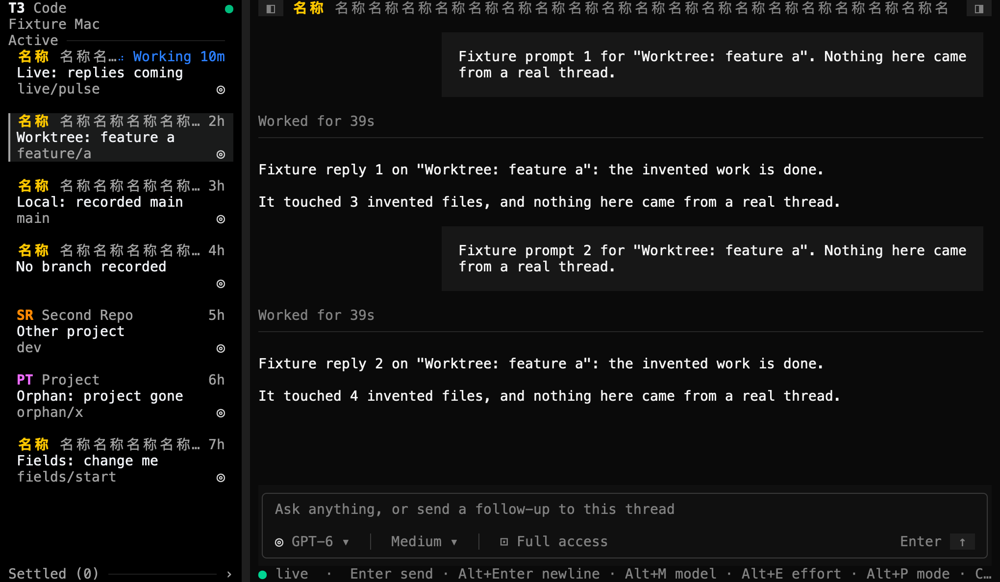
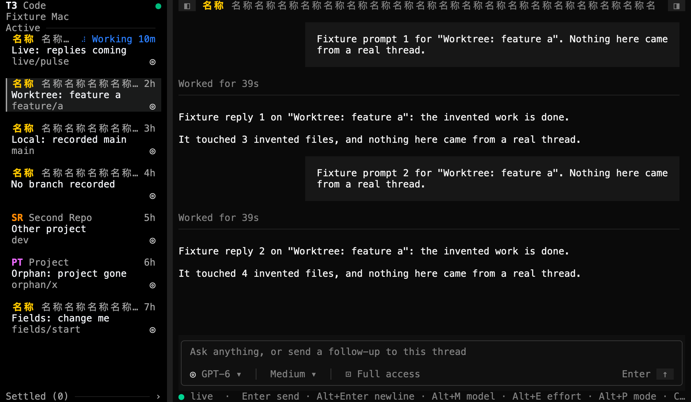
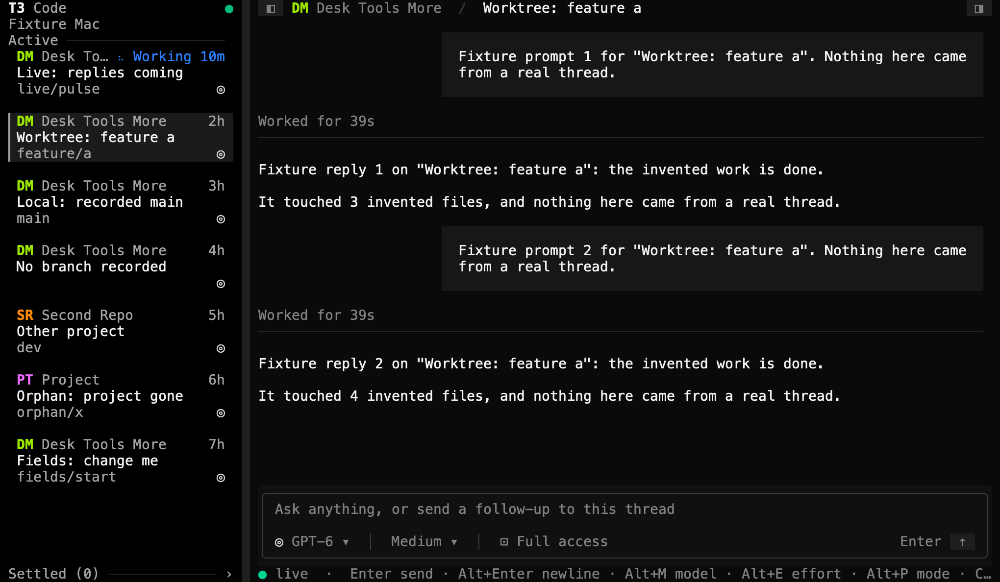

# Bounded titles verification

This page records how GPT-6.1 Sol checked [PR #31](https://github.com/krishhgg/t3term/pull/31) on 2026-10-13, at source `3b86aa92eacadc046c6c8fb84a5bf6ef704eccd6`. #31 makes the breadcrumb and the sidebar's cards cut a title, a branch or a project's name to the row before reading it, and keeps each project's badge until the project changes. Nothing here measures time, CPU, memory or allocations. It isn't a nightly sync or a parity check.

## Checks

At `3b86aa9` with Rust 1.95.0, Sol ran `cargo fmt --all -- --check`, `cargo clippy --locked --all-targets -- -D warnings`, `cargo test --locked` and `cargo build --locked`, and all of them passed. The 432 tests are 398 library, 2 main, 18 CLI and 14 fake RPC tests, with no doctests. Master at `7bf41af` has 421, so the PR adds 11. The 432 count is for the PR's unmerged source.

Sol also read the round 2 fixes and found them correct. `label::cut` reads nothing for a row of no columns. The docs in `label.rs` give the read bound as `16 * (width + 2) + 1` characters, and the last of those is read only to learn whether the text goes on. The frame test accepts the environment's label alone, as `environment::chip` draws it when the address doesn't fit whole.

CI and Greptile at the PR's final head are still pending, and this page doesn't record them. The commit that adds this page, its images and the README's link changes no source or test.

## How it ran

- The before binary is the release build installed from merged master `7bf41af`, SHA-256 `b15ac65ce3ce43358a540c30d98f10b84a68b0195c73e9b8504164876c77db1b`. The after binary is the debug build of `3b86aa9`, SHA-256 `9e0b4ca0c495922126d8ca3320addfc1852ff08f56dc84d5b63753c4ef044761`.
- An existing fake-server script of about 3,400 lines, kept outside the repository, served auth and RPC on 127.0.0.1 only. Every project, thread and reply is invented. Sol ran it.
- Each run used a 120x36 truecolor screen, `env -i`, its own temporary `HOME` and `T3CODE_HOME` and `T3TERM_NO_SAVED_LOGIN=1`. No real T3 server, Keychain entry, `~/.t3`, project folder or user file took part.
- In each run Sol clicked `Worktree: feature a` in the sidebar and captured the screen. The script then changed the title of the project `proj-desk` twice, and Sol captured the screen after each change:
  1. `名称` repeated 20 times, 40 characters that take 80 columns.
  2. `Desk`, a tab, `Tools`, a carriage return, a line feed and `More`.
- Each t3term exited with status 0. Each fake server issued and revoked one session, opened and closed one socket, and stopped. Each tmux session ended too. Each run opened one shell, one thread, one config and one setup subscription, made no `server.getConfig` read and made no other read.
- The script searched the raw terminal output for its known markers and with its control-leak pattern, and every count was 0. Its screen check reads null after the stop, because the screen had closed, so this page claims no screen check after that point. The searches cover the fixture's patterns only. They don't prove that no other control sequence got through.
- The t3term installed for the user is still the `7bf41af` build. #31 isn't installed.

## What the captures show

The clock and the spinner differ between the two runs, so the frames aren't identical outside the titles.

**A long CJK name.** Both captures cut the name on each card with `…` and keep the `名称` badge in the same color. In the before capture, the Working card's name runs into its spinner with no space before `Working 10m`. In the after capture a space separates them. Both breadcrumbs let the name take the rest of the row, which #31 leaves as it was.

**Whitespace in a name.** In the before capture the breadcrumb reads `DeskToolsMore` and the cards read `DeskTools More`, and the ages on the four Desk cards sit two columns left of the ages on the other cards. In the after capture the breadcrumb and the cards read `Desk Tools More`, and the ages line up. The `DM` badge and its color are the same in both.

| Before, `7bf41af` | After, `3b86aa9` |
|---|---|
|  |  |
|  |  |

## Images

Sol took no native Terminal screenshots and made no video. Each image renders the cells captured from t3term's pane with a private Swift renderer, kept outside the repository. It draws each cell in Menlo at 14 points and 2x, 17x33 pixels a cell, with its SGR colors, so 120x36 gives 2040x1188. It adds no text, frame or cursor. Sol viewed and approved all four.

## What this doesn't show

- No timing, CPU or memory result. That a row reads only as far as it shows rests on the unit tests and on reading the source. The captures can't show it.
- Only 120x36 with the sidebar shown was captured. The 200x50, 80x24 and 40x12 sizes and the hidden sidebar ran only as offline App tests.
- The breadcrumb still lets a long project name take the whole row.
- `fit` and `clip` still read their whole input for their other callers.
- A project's badge is still worked out from its whole name on each change to the project and on every snapshot. Finding the open thread and its project is still a scan by id.
- Text with more than 16 characters for each column, such as a long run of controls or accents, is cut where reading stops. On a sidebar 6 or 7 columns wide, the branch line is blank where it used to show `…`. Neither was captured.
- No live T3 server took part, only the fake one on 127.0.0.1.

## Where the evidence is

The captures, the raw terminal output and the script's logs stay on the machine that ran the checks, in `/private/tmp/t3term-pr29-fixture-wqaz016i` for the before run and `/private/tmp/t3term-pr29-fixture-kk00zl7h` for the after run. They aren't committed or published, and neither are the script and the renderer.
