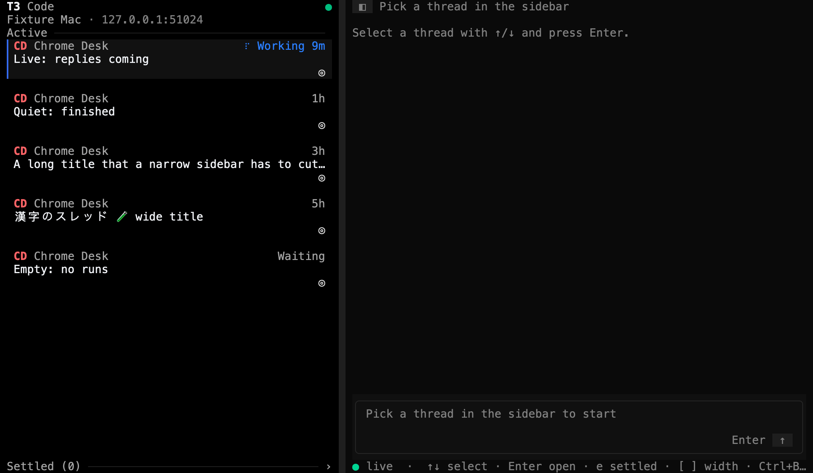
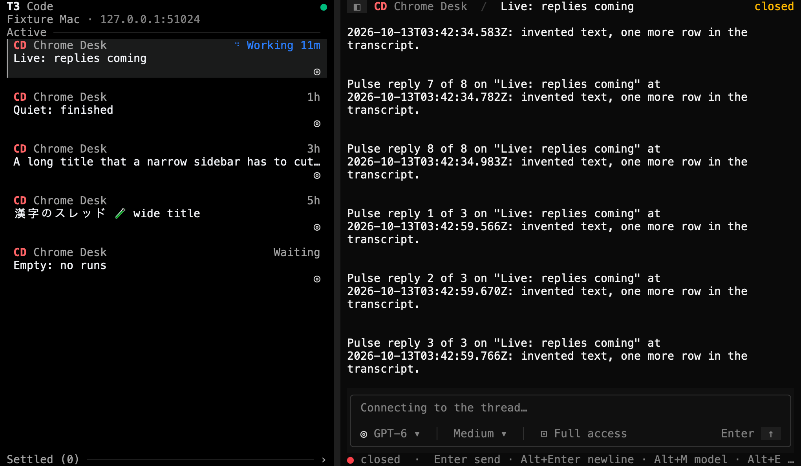
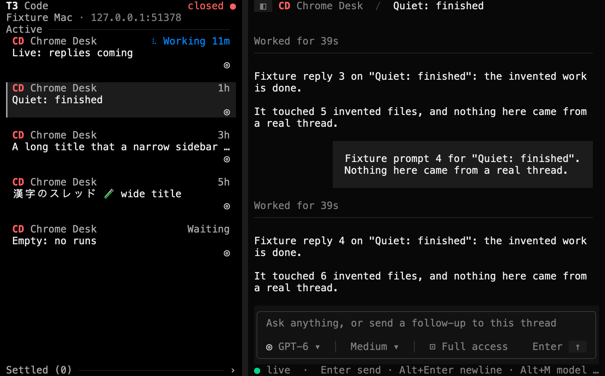
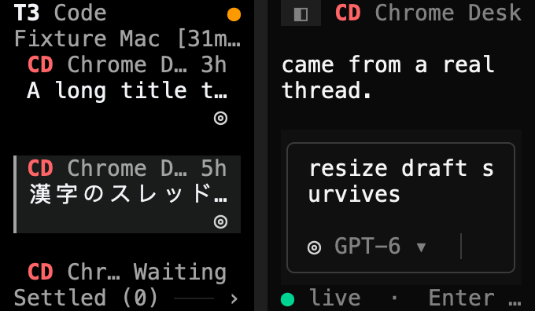
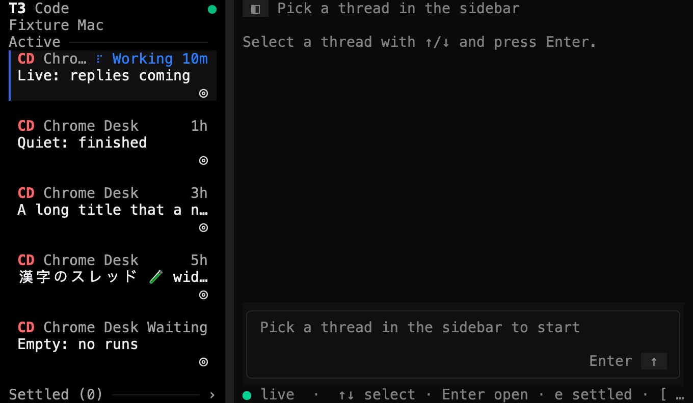
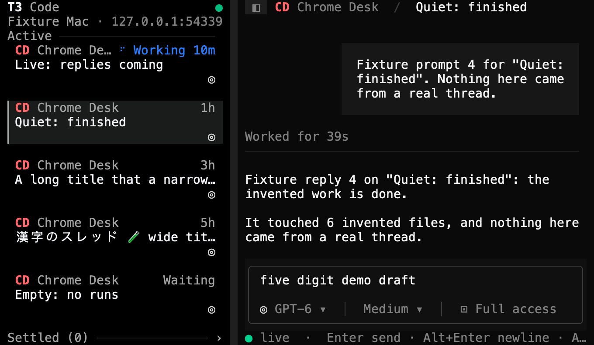

# Environment chrome verification

This page records how GPT-6.1 Sol checked the sidebar's environment row and feed dot from [PR #28](https://github.com/krishhgg/t3term/pull/28) in the t3term binary, on 2026-10-12, at source `a55c60d77d9ac0a9066cfaff28cca428db6ca8c1`. The README's [The environment and its connection](../README.md#the-environment-and-its-connection) section describes the behavior. Nothing here measures speed, CPU, memory, battery or latency. The [port preservation follow-up](#port-preservation-follow-up) at the end covers a later fix, at `c0c20d6`, with its own checks and run.

The dot shows the state of the sidebar's feed, T3's `orchestration.subscribeShell`. t3term has no monitor for the WebSocket itself, so nothing here checks one. It also connects to one environment, so nothing here checks a list or a selector.

## Checks

At `a55c60d` Sol ran `cargo fmt --all -- --check`, `cargo clippy --locked --all-targets -- -D warnings` and `cargo test --locked`, and all of them passed. The 387 tests are 353 library, 2 main, 18 CLI and 14 fake RPC tests. The pull request adds 11 of them, 4 in `src/tui/environment.rs` and 7 App tests in `src/tui/mod.rs`. [CI run 38341015700](https://github.com/krishhgg/t3term/actions/runs/38341015700) passed on macOS, job 115112008748, and on the Linux build job, 115112009049. The commit that adds this page, its images and the README's link to it changes no source or test.

## How it ran

- The debug binary that `cargo test` built at `a55c60d` ran twice. The truecolor run used 120x36 and 200x50, went to 80x24, 40x12 and 12x8, and came back. It started t3term six times, five of them restarts. The 256-color run stayed at 100x32 and started t3term once.
- A temporary Python script, kept outside the repository, served a fake T3 server on 127.0.0.1 only. Claude Opus 5.5 wrote it, and Sol ran it. It served four descriptor labels: a normal one, none, a blank one and a hostile one. It could hold, end, fail and refuse the shell subscription, withhold T3's `synchronized` marker, send replies on the open thread's own subscription, and drop the whole socket. The environment, its threads and every reply are invented.
- Each run had its own temporary `HOME` and `T3CODE_HOME`, `T3TERM_NO_SAVED_LOGIN=1` so no Keychain entry, a stand-in `t3` command that issued and revoked a made-up session, and a private tmux socket. The script starts t3term under `env -i`.
- t3term started seven times across both runs and exited with status 0 each time. The fake servers issued seven sessions and revoked all seven. Both fake servers and both tmux servers stopped, and their files stayed on disk.

## What the runs covered

Sol drove the runs through these cases and inspected the captures. The list records what Sol saw, not what the fixture expected.

- The label and the address in the sidebar's second row, with the shelf list starting on the row it did before. Sol dragged the sidebar wider with the identity in view.
- The sidebar hidden, with the dot and the identity at the end of the breadcrumb's row. A click on the identity did nothing, and the focus and the draft `demo draft kept` stayed. The draft also stayed through showing and hiding the sidebar.
- Sol had the fixture hold the feed's resubscriptions while the open thread's watch stayed live and its replies kept arriving. The dot was amber and read `reconnecting` until the feed caught up.
- The feed failed for good while the thread stayed live. The dot turned red and read `closed`, and it stayed red after the message cleared. With the sidebar hidden, the breadcrumb's row showed the closed feed.
- The thread's watch closed while the feed's dot stayed green. The breadcrumb and the status line read `closed`.
- In the 256-color run, a whole-socket drop made both the feed and the thread's watch reconnect, and both recovered.
- With the `synchronized` marker withheld, the feed stayed `reconnecting` until the marker arrived.
- A capture right after a cold start shows `connecting`.
- Changing the descriptor's label or T3's config while t3term ran left the identity as it was until a restart. With no label or a blank one, the address showed alone. The hostile label showed cleaned, its CJK, kana, Hangul and combining accent kept whole, and cut with `…` before the address and its port.
- With the sidebar showing, Sol selected a thread with a CJK title there and typed the draft `resize draft survives`. Sol then hid the sidebar and inspected the breadcrumb's row.
- A resize to 12x8 didn't crash t3term, and the draft `resize draft survives` showed whole again at 200x50. A 12x8 window clips the screen, so not every control or the identity shows there.

A restart drops an unsent draft, as it did before this pull request. The draft stays through resizes, showing and hiding the sidebar and clicks, not a restart.

An origin with a user name, password, path, query or fragment, IPv6, `localhost` and a port the scheme implies were checked only by the offline App and identity tests. The fixture served 127.0.0.1.

## Server counters

| | Truecolor | 256 colors |
|---|---|---|
| t3term starts, all exiting 0 | 6 | 1 |
| `subscribeServerConfig` | 6 | 2 |
| `subscribeShell` | 10 | 2 |
| `subscribeThread` | 3 | 2 |
| `server.getConfig` reads | 0 | 0 |
| `subscribeWorktreeSetup` requests | 0 | 0 |
| Orchestration commands | 0 | 0 |
| Sockets opened and closed | 6 and 6 | 2 and 2 |
| Sessions issued and revoked | 6 and 6 | 1 and 1 |
| Captures | 27 | 3 |

In the truecolor run, 6 of the shell subscriptions started fresh and 4 resumed from a cursor. The fixture held 5 of them and released 4, ended 4 streams without an error, failed 1 and refused 1. It sent the `synchronized` marker 8 times, withheld it once, and sent 11 replies on the open thread. The 256-color run's second socket came from its one whole-socket drop. Sol found no request that the environment row or the dot made.

## Control characters

The hostile label holds a tab, BEL, CR LF, the SGR code for red, an OSC 52 clipboard write ended by BEL, a C1 CSI and NEL, then CJK, kana, Hangul and a combining accent. Padding puts 👩‍💻 across the label's 64-character cut, and text follows past the cut and past the four-times cap on what t3term reads. In each run the fixture searched every byte t3term wrote to the pane for seven markers: the red code with its text, the clipboard write, the C1 CSI, BEL with its text, the text past the cut, the text past the cap, and the 👩 that starts the emoji. Every count was 0 in both runs. The search covers those seven markers only, so it doesn't prove that no other control byte got through.

## Idle

Sol took two idle samples in the truecolor run, in a quiet state with completed runs. With the feed live, the bytes t3term had written to the pane were 241,184 at both ends of the sample, and the server's request counts didn't change. With the feed reconnecting, they were 262,520 at both ends, and the counts didn't change either. Each is one observation of one stretch. It doesn't say how long t3term stays idle, and a working thread's spinner still redraws while a run is under way.

## Images

Sol took no native Terminal screenshots. Each image renders one `tmux capture-pane -p -e` capture, the cells tmux held for t3term's pane, with the temporary Swift renderer from the [provider status check](provider-status-verification.md#images), kept outside the repository. It draws each cell's character with its SGR colors and bold, in Menlo with macOS fallback fonts for CJK and emoji. It adds no text, frame or cursor. Sol inspected the eight below. The truecolor captures are 120x36 except the hostile label at 200x50 and the narrow one at 40x12, and the 256-color capture is 100x32.

| Identity, sidebar dragged wider, truecolor 120x36 | Sidebar hidden, truecolor 120x36 |
|---|---|
|  |  |

| Feed reconnecting beside a live thread, truecolor 120x36 | Feed closed beside a live thread, truecolor 120x36 |
|---|---|
|  |  |

| Thread watch closed beside a live feed, truecolor 120x36 | Feed closed, xterm-256 100x32 |
|---|---|
|  |  |

| Hostile label, truecolor 200x50 | Narrow, truecolor 40x12 |
|---|---|
| ![No thread open. The sidebar's second row reads Fixture Mac [31mred ]52;c;eA==osc 2J bel 漢字かな한글 café zzzzzzz… · 127.0.0.1:51024: the printable rest of the escape codes with their control characters gone, the CJK, kana, Hangul and accented letter whole, and the label cut with … before the address and its port](screenshots/environment-unicode.png) |  |

The [capture slideshow](screenshots/environment-capture-slideshow.mp4) is an 18-second H.264 video at 1600x980 and 30 frames a second. It holds six truecolor captures still for 3 seconds each: the identity, the hidden sidebar, the reconnecting feed, the closed feed, the closed thread watch and the hostile label. Sol checked it with ffprobe, decoded every frame and inspected samples. It is a slideshow of still captures, not a recording, so it doesn't show how long each step took.

## What this doesn't show

- The fake servers spoke real TCP and WebSocket, but only on loopback, 127.0.0.1. No live T3 server or remote host took part.
- The dot is the feed's state. A connection problem the feed doesn't see doesn't show.
- The label is read once, at start, and t3term connects to one environment.
- Credentials in an origin, IPv6, `localhost` and implied ports were checked only offline.
- Small windows clip the screen. At 12x8 neither every control nor the identity shows.
- The idle samples cover one stretch each, and the control-character search covers seven markers.

## Where the evidence is

The captures, their plain-text copies, the raw terminal output and the fixture logs stay on the machine that ran the checks, in `/private/tmp/t3term-pr28-fixture-yolgse82` and `/private/tmp/t3term-pr28-fixture-8q_6g76a`. They aren't committed or published, and neither are the fixture script and the renderer. The images on this page render t3term's captured terminal output, and everything in them comes from the fake server. They are not screenshots of a terminal app, or of t3term connected to a live T3 server.

## Port preservation follow-up

Everything above checked source `a55c60d`. This section covers a later fix, at source `c0c20d6978b67e8e5cef497fdbda19f0df54f6ec`, and its numbers are its own.

Greptile found that at `a55c60d` the sidebar's row could cut a port. At 80 columns, `Studio Mac` left 10 columns for the address, and `127.0.0.1:51024` showed as `127.0…1024`. The eight images and the slideshow above come from `a55c60d`. Their addresses show whole only because their rows were wide enough, or, in the narrow one, because the address was left out, so they don't show the fix.

Commit `14e50f2` adds four tests, and `c0c20d6` changes how an address is cut:

- An IP address, IPv4 or IPv6, shows whole with its port or doesn't show at all. IPv6 keeps its brackets.
- A domain name is cut in the middle in front of its whole port, keeping at least three characters at each end, as in `stu…com:3773` for `studio.example.com:3773`.
- An address that doesn't fit either way is left out. The label still comes first and is cut only after the address is gone, in the sidebar's row and in the breadcrumb's row.
- t3term works out the port's length and whether the host is a domain name once, when it parses the origin at start. Drawing a frame parses nothing.

### Checks

Sol checked out `14e50f2` on its own, built it in a separate target directory and ran `cargo test --locked --lib whole_port`. All four new tests failed against the old code. Among the strings they reported were `Studio Mac · 127.0…1024` and `[::1…024`. At `c0c20d6` Sol ran `cargo fmt --all -- --check`, `cargo clippy --locked --all-targets -- -D warnings` and `cargo test --locked`, and all of them passed. The 391 tests are 357 library, 2 main, 18 CLI and 14 fake RPC tests, the 387 above plus the four new ones. [CI run 38346457442](https://github.com/krishhgg/t3term/actions/runs/38346457442) passed at `c0c20d6` on macOS, job 115128919451, and on the Linux build job, 115128919309.

Two of the new tests are in `src/tui/environment.rs`. They fit 13 identities to every width from 0 to 64 columns, with IPv4, IPv6, `localhost` and domain addresses, ports of 1, 4 and 5 digits, no label, and labels with CJK or combining characters. The other two are App tests in `src/tui/mod.rs`. They draw the sidebar's row and the breadcrumb's row at 80 columns, with the sidebar dragged wider and with it hidden, and at widths up to 200. The fix also changed four older assertions that expected `127.0…3773` or `[::…773`.

### The fake-server run

Sol ran one more fake-server run at `c0c20d6`, set up as above. The fake T3 server listened on 127.0.0.1 only, at port 54339, picked at random, and served the normal label, `Fixture Mac`. The run had its own temporary `HOME` and `T3CODE_HOME`, `T3TERM_NO_SAVED_LOGIN=1`, `env -i`, the stand-in `t3` command and a private tmux socket. The terminal was truecolor, at 80x24 and then 120x36.

t3term started once and exited with status 0. The server issued one session and revoked it, and opened and closed one socket. It received one `subscribeShell`, one `subscribeServerConfig` and one `subscribeThread`, and no `server.getConfig` read, `subscribeWorktreeSetup` request or orchestration command. All seven control-character counts were 0, which says little here, since the label held no control characters. The fake server and the tmux server stopped, and their files stay on disk in `/private/tmp/t3term-pr28-fixture-r5a30jjy`.

Sol inspected six captures:

- At 80x24, with the sidebar at its default width, the sidebar's row read `Fixture Mac` alone.
- With the sidebar's edge dragged to column 26, 10 columns were left for the address, and the row read `Fixture Mac` alone. At column 30, with 14 columns, it still did.
- At column 31, 15 columns held `127.0.0.1:54339`, and the row read `Fixture Mac · 127.0.0.1:54339`. In the same capture `Quiet: finished` is selected and the composer holds the draft `five digit demo draft`.
- With the sidebar hidden at 80 columns, the breadcrumb's row showed `Fixture Mac` without the address. At 120x36 it showed the whole `Fixture Mac · 127.0.0.1:54339`, and the draft was still there.

### Images

Sol rendered three of the captures with the Swift renderer described above and inspected them. Like the eight above, they render tmux's cells and are not native Terminal screenshots. The first two are 80x24 and the third is 120x36.

| Address left out, truecolor 80x24 | Whole address, truecolor 80x24 |
|---|---|
|  |  |

### What the follow-up doesn't show

- Domain names and IPv6 were checked only by the offline tests. The fixture served 127.0.0.1, so no cut domain name showed on screen, and nothing used DNS or an IPv6 network.
- Credentials in an origin are still checked only offline.
- t3term keeps at most 253 characters of a host, the longest a DNS name can be, and a longer one already ends in `…`. Cutting it again would show two, and no test covers that.
- This run measured no speed, CPU, memory or idle behavior, and there is no new recording.
