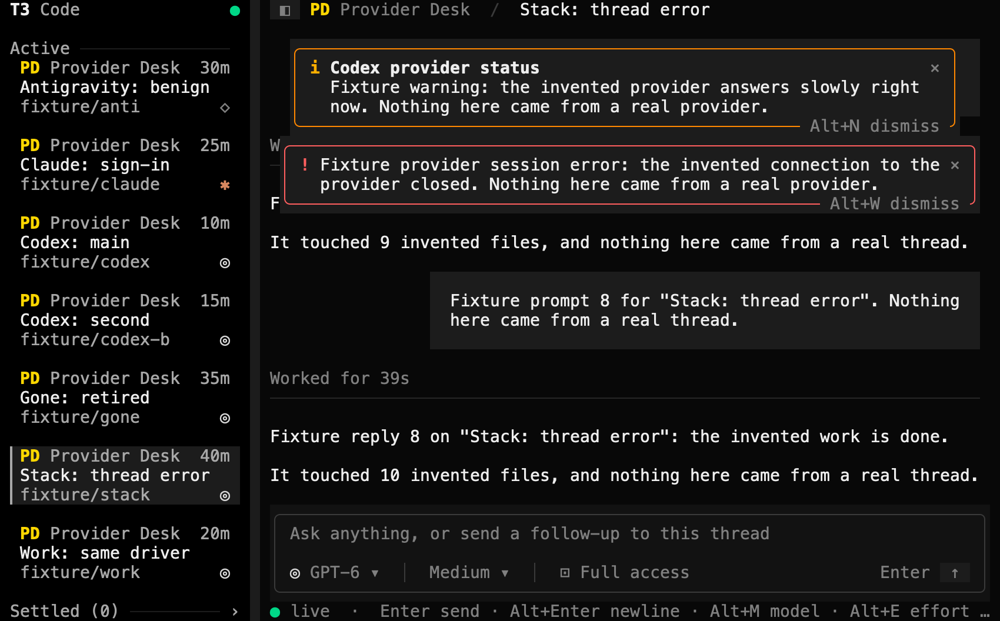
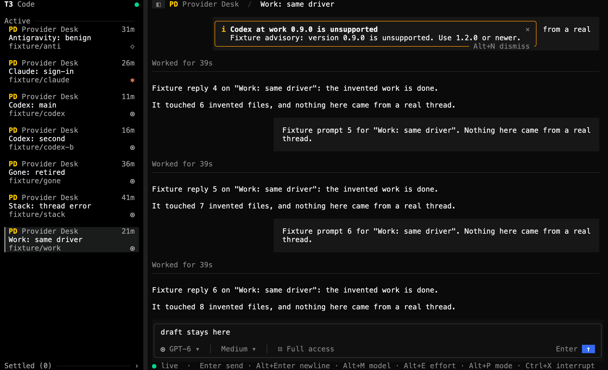
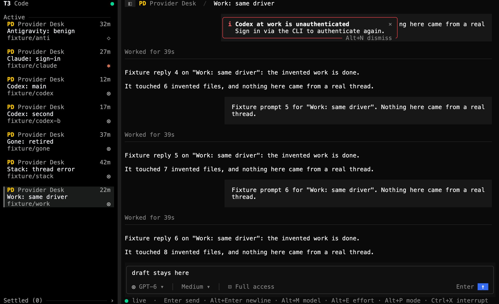
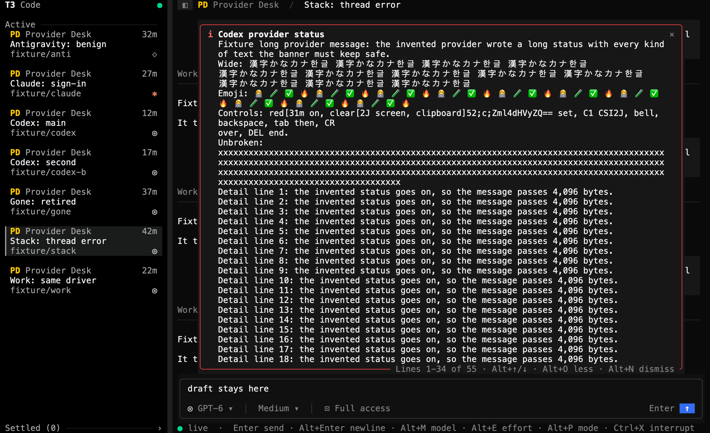
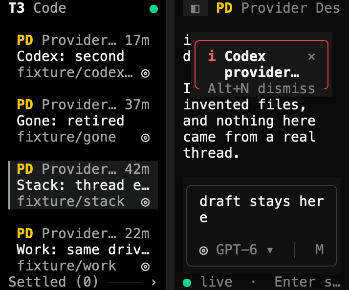

# Provider status verification

This page records how GPT-6.1 Sol checked the provider status banner from [PR #25](https://github.com/krishhgg/t3term/pull/25) in the t3term binary, on 2026-10-12, at source `d4ed7d22bffe4876f5340a613559a4e4203514ab`. The README's [Provider status](../README.md#provider-status) section describes the behavior. Nothing here measures speed, CPU or battery.

## Checks

At `d4ed7d2` Sol ran `cargo fmt --all -- --check`, `cargo clippy --locked --all-targets -- -D warnings`, `cargo test --locked` and a debug build, and all of them passed. The 331 tests are 303 library, 2 main, 18 CLI and 8 fake RPC tests. The pull request adds 18 of them to `src/tui/provider.rs` and 8 App tests to `src/tui/mod.rs`. CI run 38304453567 passed on macOS and on the optional Linux job. The commit that adds this page, its images and the README's link to it changes no source.

## How it ran

- The debug build from `d4ed7d2` ran twice. The truecolor run started at 140x44, went to 42x18 and 10x5, came back to 140x44, and then restarted t3term once. The 256-color run stayed at 100x32.
- A temporary Python script, kept outside the repository, served a fake T3 server on 127.0.0.1 only. Claude Opus 5.5 wrote it, and Sol ran it.
- Each run had its own temporary `HOME` and `T3CODE_HOME`, `T3TERM_NO_SAVED_LOGIN=1` so no Keychain entry, and a private tmux socket. t3term ran under `env -i`.
- The fake config lists Codex and Codex at work, two instances of the Codex driver, and Claude and Antigravity. They, the Provider Desk project, its threads and every status and session are invented.
- t3term started three times, twice in the truecolor run and once in the 256-color run. Each time it exited with status 0 and didn't panic. The fake servers issued three sessions and revoked all three, and opened and closed four sockets. The fake servers and the tmux servers stopped, and neither run wrote a settings file.

## What the TUI showed

The truecolor run, at 140x44 unless the row says otherwise:

| Step | What the TUI showed |
|---|---|
| Work: same driver, with Codex at work in warning | An amber `Codex at work provider status` with T3's warning |
| Codex at work ready on 0.9.0, a version T3 doesn't support | An amber `Codex at work 0.9.0 is unsupported` with T3's advice |
| Codex at work in error on 0.8.1, a version T3 knows is broken, with a startup failure | A red `Codex at work 0.8.1 is known to be broken`, with the advice to upgrade in place of the startup failure |
| The same, signed out | A red `Codex at work is unauthenticated` with `Sign in via the CLI to authenticate again.` |
| Antigravity: benign, installed, in warning, sign-in not checked | No banner |
| Stack: thread error, with Codex in warning and a provider session error on the thread | The amber provider banner above the red thread error, each with its own × and key, Alt+N and Alt+W |
| Alt+W | The thread error went, and the provider banner stayed |
| Codex in error with a long message | Closed, the title and three rows, the last ending in `…`, over `Alt+O more · Alt+N dismiss`. Open, `Lines 1-34 of 55`, and scrolled, `Lines 4-37 of 55` |
| 42x18, sidebar shown, the long notice closed | The red banner kept only its title, cut to `Codex provider…` over two rows, with × and `Alt+N dismiss` |
| 10x5 | One row, `i Cod… ×`, with no border |
| A dismissed notice, then 13 changes in which only `checkedAt` moved | The notice stayed hidden |
| Codex at work ready, then back on 0.9.0 | The unsupported notice showed again |
| Codex: main, with Codex at work's model picked from the model menu and not sent | Codex at work's banner, before any send |
| T3 moved the thread to Codex at work and emptied that instance's models | The same banner, found by the instance's id |
| Codex at work removed from T3's config | No banner, and no other provider's in its place |
| Codex at work back in the config | The same notice again |
| A reconnect with a fresh snapshot holding a new warning | The new warning |
| A restart after dismissing the notice | The notice showed again |

Two more results from the truecolor run:

- The draft `draft stays here` stayed in the composer through live updates, selection changes, the resizes and the reconnect, and showed whole once the width came back. The run didn't check it across the restart.
- With the transcript scrolled, Sol captured it with no banner, with a warning and with the sign-in error. With the sidebar cropped off, rows 14 to 36 of the conversation column are byte-for-byte the same in all three, so the transcript under the banners didn't move.

The 256-color run showed the two banners stacked, then the long provider notice open at `Lines 1-16 of 95` with the thread error under it. Opening the thread error closed the provider notice back to its title and three rows. Alt+N then dismissed the provider banner and left the thread error, and Alt+W dismissed the error. The amber border was RGB 254,154,0 and the red one 251,65,74 in truecolor, and palette entries 208 and 203 in 256 colors.

## Server counters

| | Truecolor | 256 colors |
|---|---|---|
| `subscribeShell` | 3 | 1 |
| `subscribeServerConfig` | 3 | 1 |
| `subscribeThread` | 6 | 1 |
| Config changes sent | 27 | 2 |
| `server.getConfig` reads | 0 | 0 |
| Orchestration commands | 0 | 0 |
| Sockets opened and closed | 3 and 3 | 1 and 1 |
| Sessions issued and revoked | 2 and 2 | 1 and 1 |

The truecolor run's 27 config changes include the 13 `checkedAt` changes. It also had one reconnect, with a thread replay, and one restart. With no config read and no command in either run, dismissing, opening and scrolling a banner neither read the config nor sent T3 a command.

## Control characters

The long message plants ESC sequences for red text and a screen clear, an OSC 52 clipboard write ended by BEL, a C1 CSI, BEL, BS, TAB, CR and DEL. In each run the fixture searched every byte t3term wrote to the pane for four of them, each with the text after it: the clipboard write, the C1 CSI, the red color code and the clear-screen code. Every count was 0 in both runs. The search covers those four sequences only, so it doesn't prove that no other control byte got through.

## Images

Native Terminal screenshots weren't taken. Each image renders one `tmux capture-pane -p -e` capture, the cells tmux held for t3term's pane, with a temporary Swift renderer kept outside the repository. Claude Opus 5.5 wrote the renderer, and Sol compiled and ran it. It draws each cell's character with its SGR colors and bold on the terminal's grid, in Menlo with macOS fallback fonts for CJK and emoji. Box-drawing characters, such as the banners' borders, are drawn as lines, and the terminal's default colors as t3term's theme, f5f5f5 text on 0a0a0a. It adds no text, frame or cursor. Sol rendered all 32 captures with no warning about a skipped code or an overflowing row, and inspected the six below.

| Stacked, truecolor 140x44 | Stacked, xterm-256 100x32 |
|---|---|
|  |  |

| Unsupported version, truecolor 140x44 | Signed out on a broken version, truecolor 140x44 |
|---|---|
|  |  |

| Long notice open, truecolor 140x44 | Narrow, truecolor 42x18 |
|---|---|
|  |  |

The [capture slideshow](screenshots/provider-status-capture-slideshow.mp4) is a 21-second H.264 video at 1600x976. It holds six truecolor captures still, one after another: the Codex at work warning, the unsupported version, the sign-in error, the broken version, the stacked banners and the open long notice. Sol checked it with ffprobe and decoded every frame. It is a slideshow of still captures, not a recording, so it doesn't show how long each step took.

## What this doesn't show

- Nothing here ran against a live T3 server or a real provider.
- The live long message had no combining marks or variation selectors. The long-text test in `src/tui/provider.rs` covers them offline.
- Neither run had a model-list read answer after a newer config, or a T3 that refuses the config subscription. Offline tests cover both.
- The banner follows the provider the composer's model chip names, not the desktop's fallbacks to another provider. t3term has no provider setup, so its advice points to T3 Code's. Long titles wrap. With very little room the thread error gets the rows first. The window remembers one dismissed notice, in memory only.

## Where the evidence is

The captures, their plain-text copies, the raw terminal output and the asciicast recordings of both runs stay on the machine that ran the checks, in `/private/tmp/t3term-pr25-fixture-ef7juidy` and `/private/tmp/t3term-pr25-fixture-9nz226y8`. They aren't committed or published, and neither are the fixture script and the renderer. The images on this page render t3term's captured terminal output, and everything in them comes from the fake server. They are not screenshots of a terminal app, or of t3term connected to a live T3 server.
