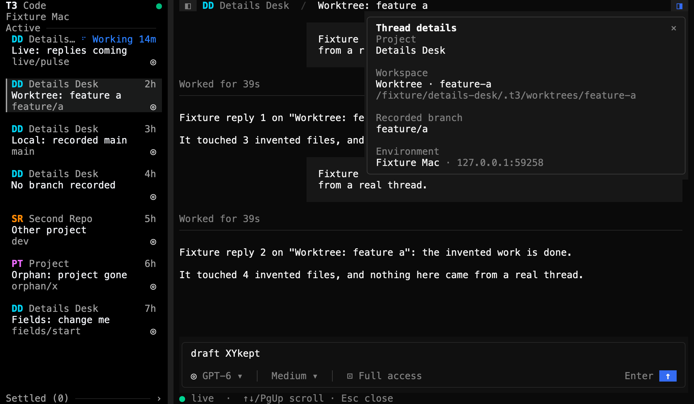
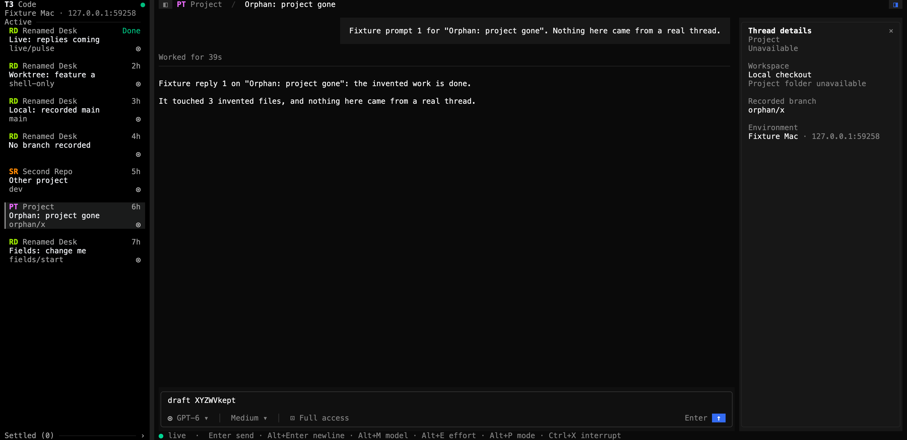
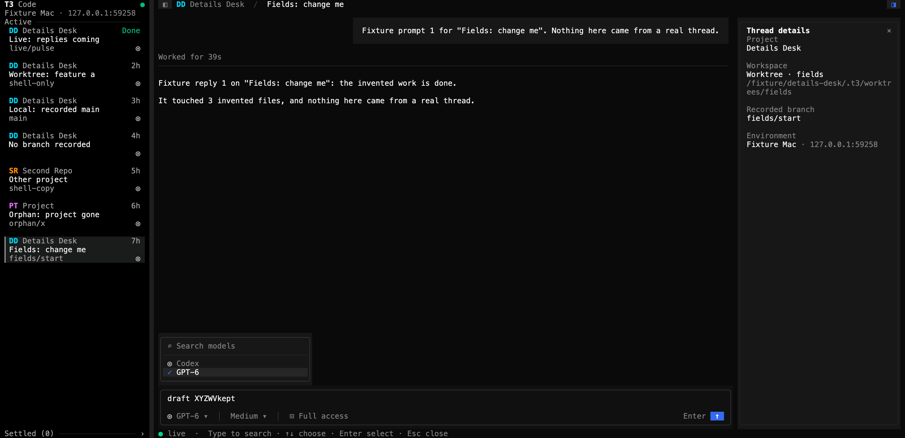
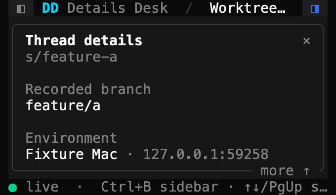

# Thread details verification

This page records how GPT-6.1 Sol checked the thread details from [PR #29](https://github.com/krishhgg/t3term/pull/29) in the t3term binary, on 2026-10-13, at source `e1df4c0bd36b9a88be73e20c7e9bbe7ea9bafe4c`. The README's [Thread details](../README.md#thread-details) section describes the behavior. Nothing here measures speed, CPU, memory, battery or latency.

The details only show values. t3term has no actions, Git status, scripts or tabbed right panel beside them, so nothing here checks those.

## Checks

At `e1df4c0` Sol ran `cargo +1.95.0 fmt --all -- --check`, `cargo clippy --locked --all-targets -- -D warnings`, `cargo test --locked` and `cargo build`, and all of them passed. The 419 tests are 385 library, 2 main, 18 CLI and 14 fake RPC tests. The pull request adds 28 of them, 15 in `src/tui/details.rs` and 13 App tests in `src/tui/mod.rs`. [CI run 38365082240](https://github.com/krishhgg/t3term/actions/runs/38365082240) passed on macOS and on the optional Linux job. Greptile reviewed `e1df4c0`, scored it 5/5 and left no inline findings. The commit that adds this page, its images and the README's link to it changes no source or test.

## How it ran

- The binary `cargo build` built at `e1df4c0` ran twice. The truecolor run started at 200x50 and went down to 120x36, 80x24, 40x12 and 10x5 before coming back. The 256-color run used 100x32 and 80x24 and started with a hostile environment label.
- A temporary Python script, kept outside the repository, served a fake T3 server with its HTTP, WebSocket and auth endpoints on 127.0.0.1 only. Claude Opus 5.5 wrote it, and Sol ran it. It refused every orchestration command. Every project, thread, path, branch and reply is invented.
- Each run had its own temporary `HOME` and `T3CODE_HOME`, `T3TERM_NO_SAVED_LOGIN=1` so no Keychain entry, a stand-in `t3` command and a private tmux socket. The script starts t3term under `env -i`. No real `~/.t3`, `.env`, project folder or live T3 server took part.
- Each run started t3term once, with no restart, and it exited with status 0. Each fake server issued one session and revoked it, and opened and closed one socket. Both fake servers and both tmux servers stopped.

## What the runs covered

Sol drove the runs through these cases and inspected the captures. The list records what Sol saw. The script's own predictions don't count as results.

**Opening and focus, truecolor 200x50.** The details started closed. Alt+B with no thread open showed the environment. With `Worktree: feature a` open, the pane read `Details Desk`, `Worktree · feature-a`, its path, the recorded branch `feature/a` and the environment. Sol typed `draft kept`, moved the cursor four places left, opened the pane and typed X, giving `draft Xkept`. Sol then closed and opened the details with ◨, closed them with ×, opened them with the key, pressed Esc to reach the transcript and Tab to reach the pane, left it with Esc, clicked `Recorded branch`, closed and reopened with Alt+B, and pressed Enter to get back to the composer. Typing Y gave `draft XYkept`.

**Sizes.**

- At 120x36 with the sidebar shown, the details were a dialog. Typing `BLOCKED` did nothing, and the draft stayed as it was. Ctrl+B hid the sidebar and the dialog became a pane, and Z went in at the saved cursor.
- At 80x24 with the sidebar hidden, the details were a dialog again. The wheel scrolled it, Esc closed it and W then went into the draft. A click outside closed it without reaching what was under it.
- At 40x12, End scrolled to the last rows and the environment, with `more ↑` showing. At 10x5 the details drew cropped and without a border.
- Back at 200x50 the pane and the draft came back, and V typed after that frame gave `draft XYZWVkept`. The first capture Sol took after the restore came before t3term had drawn the new frame and still showed the small layout, and a V sent while the dialog still showed did nothing. A later capture shows the restored pane. This page doesn't use the early capture and doesn't time the redraw.

While Sol opened, closed, clicked, focused, scrolled and resized, the server's request counts didn't move. There was one `subscribeServerConfig`, one `orchestration.subscribeShell`, one `orchestration.subscribeThread` and one `subscribeWorktreeSetup` before and after.

**Live updates.**

- A branch change to `feature/b` showed. A branch of `shell-only` sent only on the sidebar's feed changed the sidebar's card, while the details kept `feature/b` from the thread's own copy.
- Clearing the worktree path turned the workspace into `Local checkout`. Renaming the project to `Renamed Desk` and moving its folder to `/fixture/moved-desk` changed both in the details.
- With the thread's project missing, the details read `Unavailable` and `Project folder unavailable`. Adding that project brought `Found Later` and `/fixture/found-later`. An empty title and a null folder read `Untitled` and `Project folder unavailable`, and removing the project brought the missing state back.

**Thread switches and late data.**

- Sol had the script hold back `Other project`'s snapshot and switched to it from `Local: recorded main`. While the snapshot was held back, the details showed the feed's `Second Repo`, `/fixture/second-repo` and `dev`. One message sent afterwards on `Local: recorded main`'s old subscription, which t3term had let go of, never showed.
- With `No branch recorded`'s watch held, removing the thread from the feed gave `Loading…` in its project, workspace and branch rows. After its watch failed they read `Unavailable`. Putting the thread back showed the current project, its local folder and `None recorded`.
- For `Other project`, a branch sent only on the thread's watch showed over the feed's `shell-copy` until the watch failed, and then `shell-copy` showed.

**Fields.** The truecolor run sent seven sets of fields: start, hostile, long, malformed, missing, blank and control characters. Long paths, branches and titles wrapped inside the panel and stopped at their row limits. Malformed, missing and blank fields read `Unavailable`. A path of only control characters isn't blank, so it showed `Worktree` with no path. Control characters were gone from the hostile values, but the printable rest of an escape sequence, such as `]52;c;` or `31m`, can still show as plain text. The 256-color run checked a hostile label, branch and worktree path, huge fields in a pane with the sidebar hidden, and malformed fields at 80x24 and the recovery after them.

**Menus and streaming.** The model menu opened beside the pane. A running thread received five streamed replies from the fake server, and the fifth showed while the details kept its recorded branch `live/pulse` and local checkout. The fake run then completed.

## Server counters

| | Truecolor | 256 colors |
|---|---|---|
| t3term starts, all exiting 0 | 1 | 1 |
| `subscribeServerConfig` | 1 | 1 |
| `orchestration.subscribeShell` | 1 | 1 |
| `orchestration.subscribeThread` | 8 | 1 |
| `subscribeWorktreeSetup` | 3 | 1 |
| `server.getConfig` reads | 0 | 0 |
| Orchestration commands | 0 | 0 |
| Sockets opened and closed | 1 and 1 | 1 and 1 |
| Sessions issued and revoked | 1 and 1 | 1 and 1 |
| Field changes sent | 14 | 3 |
| Captures | 35 | 3 |

The truecolor run also sent seven project changes, five streamed replies and the one late message. Of the 38 captures, this page leaves out the early restore capture described above. Not every capture was rendered as an image, and only the eight below are published.

## Control characters

The hostile fields plant the SGR code for red, an OSC 52 clipboard write, a C1 CSI and BEL. They also put text past the label's cut and past its cap, an emoji across the label's cut, text past the branch's and the title's caps, and text in the middle of a huge path. In each run the script searched every byte t3term wrote to the pane for 11 markers: those 10 and the late message's text. Every count was 0 in both runs, and in the truecolor run since the fields began. The screen's marker counts were 0 too. The search covers those markers only, so it doesn't prove that no other control byte got through.

## Idle

Sol had the script complete the running thread, which wasn't the one open, and took two quiet samples. With the details open, the bytes t3term had written to the pane were 180,404 at both ends. With them closed, 184,107 at both ends. The server's request counts didn't change. Each is one observation of one stretch and doesn't say how long t3term stays idle.

## Images

Sol took no native Terminal screenshots. Each image renders one `tmux capture-pane -p -e` capture, the cells tmux held for t3term's pane, with the temporary Swift renderer from the [provider status check](provider-status-verification.md#images), kept outside the repository. It draws each cell in Menlo at 14 points and 2x, 17x33 pixels a cell, with its SGR colors and bold, and adds no text, frame or cursor. Sol inspected all eight.

| Pane, truecolor 200x50 | Dialog with the sidebar shown, truecolor 120x36 |
|---|---|
|  |  |

| Sidebar hidden, truecolor 120x36 | After live updates, truecolor 200x50 |
|---|---|
|  |  |

| Missing project, truecolor 200x50 | Model menu beside the pane, truecolor 200x50 |
|---|---|
|  |  |

| Narrow, truecolor 40x12 | Hostile fields, xterm-256 100x32 |
|---|---|
|  |  |

The [capture slideshow](screenshots/thread-details-capture-slideshow.mp4) is an 18-second H.264 video at 1600x980 and 30 frames a second. It holds six still captures for 3 seconds each: the pane, the dialog, the hidden sidebar, the live updates, the missing project and the 256-color hostile fields. Sol checked its length and format, decoded every frame and inspected one. It is a slideshow of static captures, not a recording of the steps, so it doesn't show how long anything took.

## What this doesn't show

- The fake servers spoke real HTTP and WebSocket, but only on 127.0.0.1. No live T3 server took part.
- The script's worktree setup subscription always answered null, and its provider config was ready. Setup cards, provider banners and approvals beside the details were checked only by offline tests and by reading the source.
- The 3-million-character paths ran only in offline tests. No real path that long was read.
- The details drop control characters, but the printable text of an escape sequence can stay.
- The marker searches cover planted markers only, and the idle samples cover one stretch each.

## Where the evidence is

The captures, the raw terminal output and the script's logs stay on the machine that ran the checks, in `/private/tmp/t3term-pr29-fixture-8a0j1xv5` and `/private/tmp/t3term-pr29-fixture-6lrmgw7n`. They aren't committed or published, and neither are the script and the renderer. The images on this page render t3term's captured terminal output, and everything in them comes from the fake server.
