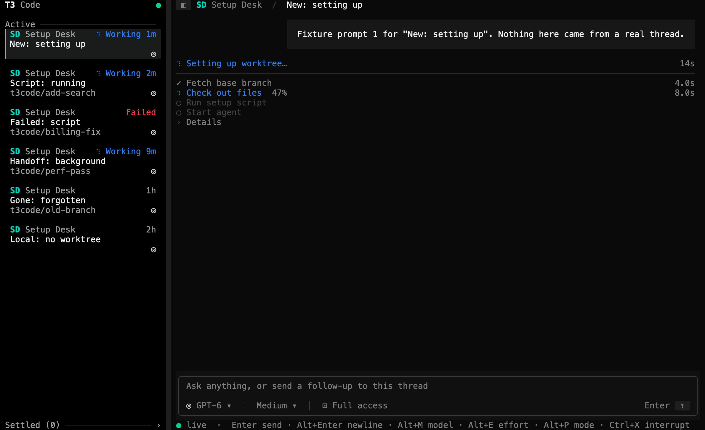
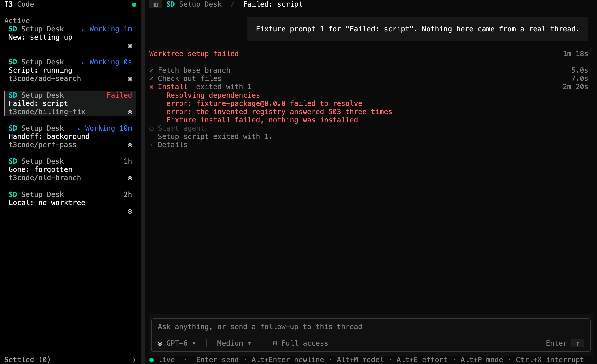
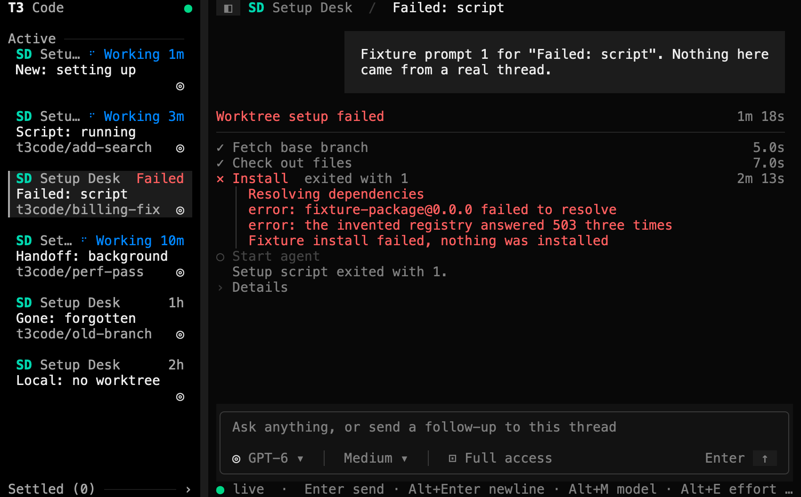
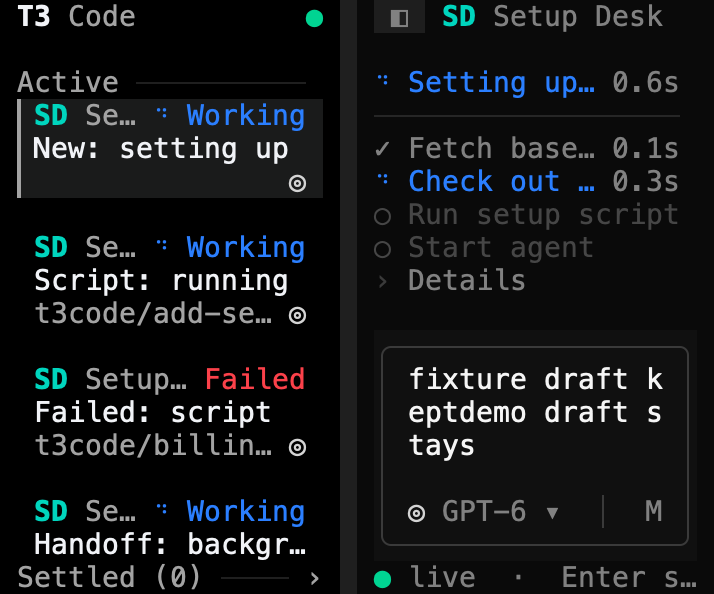

# Worktree setup verification

This page records how GPT-6.1 Sol checked the worktree setup card from [PR #27](https://github.com/krishhgg/t3term/pull/27) in the t3term binary, on 2026-10-12, at source `621e8acdc745e727df5795bfd8aded43d9ebca3c`. The README's [Worktree setup](../README.md#worktree-setup) section describes the behavior. Nothing here measures speed, CPU, memory, battery or latency.

The card only shows a setup's progress and details. Nothing here checks the desktop's Cancel, Work locally or Open terminal actions, which t3term doesn't have, and the card doesn't finish the parity row for worktree setup progress and the setup terminal.

## Checks

At `621e8ac` Sol ran `cargo fmt --all -- --check`, `cargo clippy --locked --all-targets -- -D warnings`, `cargo test --locked` and a debug build, and all of them passed. The 374 tests are 340 library, 2 main, 18 CLI and 14 fake RPC tests. The pull request adds 32 of them, 15 in `src/tui/setup.rs` and 17 App tests in `src/tui/mod.rs`. [CI run 38324442513](https://github.com/krishhgg/t3term/actions/runs/38324442513) passed on macOS, job 115059742541, and on the Linux build job, 115059742485. The commit that adds this page, its images and the README's link to it changes no source or test.

## How it ran

- The debug build from `621e8ac` ran twice. The truecolor run started at 140x44, went to 40x12, 42x18 and 10x5, came back to 140x44, and restarted t3term once. The 256-color run stayed at 100x32.
- A temporary Python script, kept outside the repository, served a fake T3 server on 127.0.0.1 only. Claude Opus 5.5 wrote it, and Sol ran it. It sent invented setups, nulls, ended streams and refusals down `subscribeWorktreeSetup`. No real command ran, no worktree was created and no setup script ran. Every stage, output line, branch and path is invented.
- Each run had its own temporary `HOME` and `T3CODE_HOME`, `T3TERM_NO_SAVED_LOGIN=1` so no Keychain entry, and a private tmux socket. The script starts t3term under `env -i`.
- t3term started three times, twice in the truecolor run and once in the 256-color run, and exited with status 0 each time. Both fake servers and both tmux sessions stopped.

## What the runs covered

Sol drove the truecolor run through these cases and inspected the captures. The list records what Sol saw, not what the fixture expected.

- The stages, with the checkout at 47%, and the setup script's last output lines.
- Details opened and closed with `w` and with a click.
- A setup that finished cleanly, before the agent's turn started and after.
- A failed setup script: the whole card, the one-row summary once the turn was live, and the card going after a follow-up.
- A script still running after the agent started, as one row with Details open.
- Thread switches, and which threads subscribe by their worktree path.
- Malformed setups, setups for another thread and stale setups.
- Null, then a setup numbered 0.
- A fake socket reconnect with a thread replay, a subscription again after T3 ended a stream without an error, and a closed thread.
- A refusal, after which t3term asked for no more setups, and a restart that cleared it.
- Made-up CJK, Hangul, emoji, combining marks and overlong text with control characters, captured with the card in view.
- The composer's draft through the resizes down to 10x5 and back. Small windows clip the card.

One whole fake preparation of 26 steps played to the end. An earlier play stopped when the fake server restarted.

## Server counters

| | Truecolor | 256 colors |
|---|---|---|
| `subscribeWorktreeSetup` requests | 18 | 2 |
| `subscribeServerConfig` | 3 | 1 |
| `subscribeShell` | 3 | 1 |
| `subscribeThread` | 17 | 2 |
| `server.getConfig` reads | 0 | not reported |
| Orchestration commands | 0 | not reported |
| Sockets opened and closed | 3 and 3 | 1 and 1 |
| Sessions issued and revoked | 2 and 2 | 1 and 1 |
| Captures | 41 | 2 |

In the truecolor run every setup request's payload had exactly one key, `threadId`. The run had one fake socket reconnect with a thread replay, one refusal, two streams that T3 ended without an error, and eight nulls. So opening Details, switching threads and the reconnect read no config and sent T3 no command.

## Control characters

The made-up text plants five sequences, each followed by marker text: an OSC 52 clipboard write, a C1 CSI, the SGR code for red, the clear-screen code and BEL. In each run the fixture searched every byte t3term wrote to the pane for each of them. Every count was 0 in both runs. The search covers those five sequences only, so it doesn't prove that no other control byte got through.

## Idle

In one idle stretch the card still showed a running setup, the thread's run had finished and the sidebar was hidden. t3term wrote no bytes to the pane between two of the fixture's `status` samples. That is one observation of one stretch. It doesn't say how long t3term stays idle.

## Images

Native Terminal screenshots weren't taken. Each image renders one `tmux capture-pane -p -e` capture, the cells tmux held for t3term's pane, with the temporary Swift renderer from the [provider status check](provider-status-verification.md#images), kept outside the repository. It draws each cell's character with its SGR colors and bold, in Menlo at 14 points and 2x, with macOS fallback fonts for CJK and emoji. It adds no text, frame or cursor. Sol inspected the seven below. The truecolor captures are 140x44 except the narrow one at 42x18, and the 256-color capture is 100x32.

| Checkout, truecolor 140x44 | Script output and Details, truecolor 140x44 |
|---|---|
|  |  |

| Failed setup, truecolor 140x44 | Failed setup, xterm-256 100x32 |
|---|---|
|  |  |

| Script still running after the agent started, truecolor 140x44 | Narrow, truecolor 42x18 |
|---|---|
|  |  |

| Made-up Unicode and control text, truecolor 140x44 |
|---|
| ![Handoff: background with a running setup made of hostile text: stage notes and output lines in CJK, kana, Hangul, emoji and repeated accented letters, and the printable rest of escape sequences such as red[31mfixture-red and clipboard]52;c;c2V0dXA=, each cut with … at the card's edge. Details is open, and the long branch, base and path are cut in the middle so both ends show](screenshots/worktree-setup-unicode.png) |

In the failure captures Install reads longer than the setup's total, and differently in the two runs. The fake failed stage has no `endedAt`, so its time runs to when t3term laid the card out, as the desktop's `stageElapsedMs` counts a stage with no end.

The [capture slideshow](screenshots/worktree-setup-capture-slideshow.mp4) is an 18-second H.264 video at 1600x980 and 30 frames a second. It holds six truecolor captures still for 3 seconds each: the checkout, the script output with Details, the script still running after the agent started, the failed setup, the narrow screen and the made-up Unicode text. Sol checked it with ffprobe, decoded every frame and inspected samples. It is a slideshow of still captures, not a recording, so it doesn't show how long each step took.

## What this doesn't show

- Nothing here ran against a live T3 server, a real worktree or a real setup script.
- Small windows clip the card. The App tests draw it at heights of 12 and up.
- The idle observation covers one stretch, and the control-character search covers five sequences.
- The 256-color run reported no counts for config reads or commands.

## Where the evidence is

The captures, their plain-text copies, the raw terminal output and the asciicast recordings stay on the machine that ran the checks, in `/private/tmp/t3term-pr27-fixture-kmlfcy3q` and `/private/tmp/t3term-pr27-fixture-nqmz0i9_`. They aren't committed or published, and neither are the fixture script and the renderer. The images on this page render t3term's captured terminal output, and everything in them comes from the fake server. They are not screenshots of a terminal app, or of t3term connected to a live T3 server.
